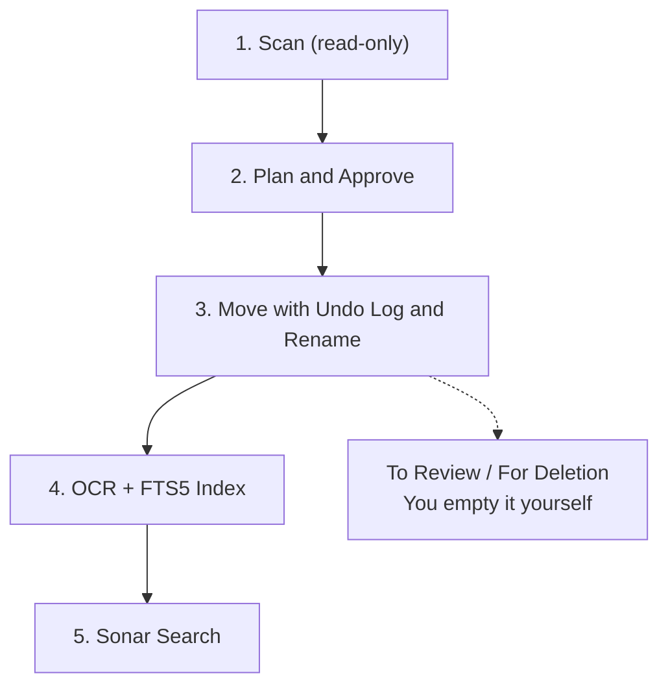

# Getting Started

A short, self-contained walkthrough for the Personal File Organization Kit. Use it in either of two ways:

1. **You cloned the repo.** Keep this file next to `AGENTS.md`, `CLAUDE.md`, and the `scripts\` tools (including **Sonar**, the search app). Open the folder in Cursor, Claude Code, Codex, or a similar agent. The agent rules load automatically; this file is the guided path through them.
2. **You only have this file.** Download just `GETTING_STARTED.md` and upload or paste it into ChatGPT, Claude, Gemini, Cursor, or any other LLM. Fill in the household block and use the [starter prompt](#starter-prompt) below. You will still need an agent that can run commands on your Windows PC to actually move files (Cursor, Claude Code, Codex, or similar). A chat-only LLM can help you plan and can hand you the prompt to paste into that agent.

All names, companies, and paths here are placeholders. Replace `<You>`, `<Spouse>`, `<Kid1>`, `<Kid2>`, `<Parents>`, `<Employer>`, `<Bank>`, and `<Brokerage>` with your own. Do not put real names or paths into a public fork of this repo — keep them in your private `config.json`.

---

## How it works

The kit is a five-stage pipeline. Every stage runs locally on your PC. Nothing is ever permanently deleted, and a file is never overwritten.



1. **Scan (read-only).** The agent inventories Desktop, Downloads, Documents, and any backups or external drives you point it at. It reads names, types, hashes, and page 1 of documents. It does not move anything yet.
2. **Plan and approve.** Every proposed move or rename is written to a plan (a manifest CSV) and shown to you with counts, samples, and a recommendation. You approve before anything is applied. Unattended bulk runs still write a plan and an undo log.
3. **Move with an undo log, and rename.** Approved plans are applied in PowerShell, without `-Force`. On a collision the file is skipped and reported. Exact SHA-256 duplicates and junk go to `To Review\For Deletion` — you empty that folder yourself. Every applied move is recorded in an undo log so it can be reversed.
4. **OCR and FTS5 index.** A scan whose first page has no text layer is read locally with OCRia Nano. That text is stored in the index. The PDF is left unchanged. Nothing is uploaded.
5. **Sonar search.** Search the cabinet from the Sonar desktop app or the terminal. Sonar can also sort a folder with preview, apply, and undo, and flag IDs that are about to expire.

---

## Safety rules (non-negotiable)

- **Never delete.** "Delete" always means *move to* `To Review\For Deletion\...`. You empty that folder yourself after a look.
- **Never overwrite.** If the target path already exists, skip the file, log it, and report it. Never use `Move-Item -Force`.
- **Dry run, then apply.** Show a plan first. Apply only after you approve, or, for an unattended run, apply with an undo log.
- **Undo log for every apply.** Every move or rename writes `Source,Dest,Time` to an undo CSV so it can be reversed.
- **Hash before calling anything a duplicate.** Only exact SHA-256 matches count. The same name or a similar size proves nothing.
- **Skip shortcuts and system files:** `.lnk`, `desktop.ini`, `thumbs.db`, `~$*` temp files, `System Volume Information`, `$RECYCLE.BIN`.
- **Never rename code or projects.** Move code, project folders, and app bundles whole.
- The agent should make small reversible calls itself, and ask you only about judgment calls — grouped, with a recommendation and an `Invoke-Item "<full path>"` command for each item you need to look at.

---

## The cabinet

Default locations (you can change them):

- Cabinet root: `%USERPROFILE%\Documents\Family`
- Review area (outside the cabinet): `%USERPROFILE%\Documents\To Review`

The top-level drawers are fixed. The subfolders shown are generic starting examples. The agent scans what you actually own, proposes additions or drops, and creates subfolders only after you approve.

```
%USERPROFILE%\Documents\Family
├── 00 Inbox
├── 10 Identity
│   ├── IDs
│   ├── Passports
│   ├── Insurance Cards
│   └── _Emergency
├── 15 Travel
│   ├── <YYYY>
│   └── Trip Ideas
├── 20 Health
│   ├── <You>
│   ├── <Spouse>
│   ├── <Kid1>
│   └── <Kid2>
├── 30 Home
│   ├── Property
│   ├── Mortgage
│   ├── Bills and Utilities
│   ├── Vehicles
│   ├── Insurance and Warranties
│   ├── Manuals
│   └── Projects
├── 40 Money
│   ├── Taxes
│   │   └── <YYYY>_Tax
│   ├── Banking
│   ├── Investments
│   ├── Retirement
│   ├── Receipts
│   └── Budget
├── 50 Legal
│   ├── Estate Planning
│   ├── Contracts
│   └── Leases
├── 60 Work
│   ├── Career
│   ├── Employers
│   │   └── <Employer>
│   │       └── Payslips
│   │           └── <YYYY>
│   └── Job Search
├── 65 Learning
│   └── <Course or Subject>
├── 70 Kids
│   ├── <Kid1>
│   │   └── <Kid1>_School
│   └── <Kid2>
│       └── <Kid2>_School
├── 75 <You>
│   └── Miscellaneous Personal Docs
├── 80 Photos
│   └── <YYYY>_Photos
└── _index

%USERPROFILE%\Documents\To Review
└── For Deletion
```

**Stable vs. recurring.** Documents that never change get one folder; documents that repeat get a folder per year. IDs, passports, birth certificates, a property deed, or a will live in a single folder (`10 Identity\Passports`). Taxes, statements, receipts, trips, and payslips come every year, so they're grouped by year (`40 Money\Taxes\2025_Tax`, `15 Travel\2025`, `60 Work\Employers\<Employer>\Payslips\2025`). When in doubt, ask: will I get a new one of these next year? If yes, organize by year; if no, keep it in one folder.

**A few placement rules worth knowing up front:**

- The mortgage lives under **Home** (`30 Home\Mortgage`), not under Money. Statements are named by date; a refinance gets its own `Mortgage\<Lender>_<YYYY>` folder.
- Payslips live under **Work**, grouped by year: `60 Work\Employers\<Employer>\Payslips\<YYYY>`. They do not go under Money.
- Your personal drawer (`75 <You>`) starts with one **Miscellaneous Personal Docs** folder. Split out a topic folder only once it has enough files to justify it.
- Put the person in the filename, not in a folder, except in Health and Kids, where a drawer is mostly per-person.
- Keep active code and git repos in a separate Projects folder outside the document cabinet so build artifacts and `.git` folders don't bloat OCR and search indexes.
- A subfolder name always needs a topic word. Never use a bare year (`2025_Photos`, not `2025`), except under `15 Travel`, where the parent folder is the topic (`15 Travel\2025`).

---

## Naming in brief

Dates are `YYYY-MM-DD` (or `YYYY-MM` / `YYYY` when that's all the document gives you). Use underscores between parts and hyphens inside a part. No spaces. The date comes from the filename or page 1, never from the file's modified time.

| Category | Pattern | Example |
|---|---|---|
| Person documents | `Person_Type_Date_Detail.ext` | `Kid1_Dental_2026-10-01_Checkup.pdf` |
| IDs and passports | `Person_DocumentType_EXP_YYYY-MM-DD.ext` | `You_DL_EXP_2030-01-31.pdf` |
| Docs that never expire | `Person_DocumentType.ext` | `Kid1_BirthCertificate.pdf` |
| Home (no person) | `Project_Type_Date_Detail.ext` | `Home_Deed_2020-03-15.pdf` |
| Money | `YYYY-MM-DD_Source_DocType_Detail.ext` | `2026-02-21_<Bank>_Statement.pdf` |
| Tax | `YYYY_Tax_Form_Source.ext` | `2025_Tax_W2_<Employer>.pdf` |
| `00 Inbox` | Leave the name as it arrived until filed | — |

---

## Path A — you cloned the repo

Do this on your Windows PC, in PowerShell.

1. **Install prerequisites** (Python 3.11+; Git is optional):

   ```powershell
   winget install -e --id Python.Python.3.12
   python -m pip install --upgrade pip
   python -m pip install -r requirements.txt
   lit models pull ocria-nano
   ```

   If PowerShell cannot find `lit`, call the copy in the Python Scripts folder:

   ```powershell
   & "$([System.IO.Path]::GetDirectoryName((Get-Command python).Source))\Scripts\lit.exe" models pull ocria-nano
   ```

   The model stays on this PC. Household files are never uploaded.

2. **Copy `config.example.json` to `config.json`** and edit it: cabinet root, review root, people tokens (`You`, `Spouse`, `Kid1`, `Kid2`, `Parents`) and nicknames, the `75 <You>` folder name, and your IANA time zone. `config.json` is git-ignored, so your details never get committed.

3. **Open the project folder in your agent.** It should read `AGENTS.md` (and `CLAUDE.md` / `.cursor\rules\agents.mdc`) automatically.

4. **Ask the agent to finish setup without moving your files yet:**

   > The scripts already exist. Create the cabinet folders, the plans files, and the shortcuts, then confirm they work. Do not move, rename, or OCR any of my real files yet.

5. **When you're ready to file things,** start with `00 Inbox`, Downloads, or Desktop. The agent scans, shows you a plan, and applies it only after you approve. Every apply writes an undo log.

6. **Build the index and open Sonar:**

   ```powershell
   python scripts\sonar_index.py index
   python scripts\sonar.py "passport"
   # or open the desktop app:
   pythonw scripts\sonar_app.pyw
   ```

The full guide, naming rules, and session protocol live in [README.md](README.md). Session prompts (per-folder and unattended bulk) are summarized there too.

---

## Path B — you only have this file

1. Upload or paste this entire file into your LLM.
2. Fill in the **MY HOUSEHOLD** block in the starter prompt below (tokens, cabinet path, time zone). Do not skip this.
3. Paste the starter prompt. If the LLM can run commands on your PC, it can do the work. If it can't (a regular ChatGPT or Claude chat, for example), ask it to prepare the plan and the exact prompt to paste into Cursor, Claude Code, Codex, or another local agent.
4. If you later clone the repo, switch to Path A. Don't invent a second copy of the scripts if the repo already has them.

### Starter prompt

Copy everything in the block below, fill in the household lines, and paste it with this file.

````text
You are setting up a local, privacy-preserving personal file-organization system on my Windows PC. Read the GETTING_STARTED.md file I provided (and README.md / AGENTS.md if they are in the current folder) and follow them. Use PowerShell and Python only. No cloud uploads.

If this folder is the file-organizer-kit repo (scripts\, AGENTS.md, config.example.json exist), use the existing scripts. Do not rewrite them. If I only gave you GETTING_STARTED.md, help me clone the repo or, if I ask you to build from this file alone, build the tools it describes. In either case: do NOT move, rename, or OCR any of my real files until setup is done and I approve a plan.

MY HOUSEHOLD (edit before running):
- Cabinet root: %USERPROFILE%\Documents\Family
- Review root:  %USERPROFILE%\Documents\To Review
- People tokens (used in filenames): <You>, <Spouse>, <Kid1>, <Kid2>, <Parents>
- Nicknames the agent should recognize: <your nicknames>
- Personal drawer name: 75 <You>
- Time zone for logs: <your IANA zone, e.g. America/Los_Angeles>

Do this, in order:
1. Confirm the safety rules: never delete (move to To Review\For Deletion instead); never overwrite; dry-run then apply; write an undo log for every apply; skip .lnk / desktop.ini / system files; hash before calling anything a duplicate.
2. Install or verify prerequisites (Python 3.11+, LiteParse, the OCRia Nano model, the Python packages) if I am on the repo path.
3. Create config.json from config.example.json using the household block above. Never commit config.json.
4. Create the empty cabinet drawers and the To Review folders, the plans files (STATUS.md, ISSUES.csv, check-exceptions.txt), and a Sonar desktop shortcut if the scripts exist.
5. Report what you created and what I should do next. Stop before touching my Desktop, Downloads, Documents, or any other real files.

After I say go, work the five-stage pipeline: scan (read-only) → plan and approve → move with undo log and rename → OCR + FTS5 index → Sonar search. Start with 00 Inbox / Downloads / Desktop unless I name a different source. Group judgment calls and include an Invoke-Item "<full path>" command for each file I need to look at.
````

---

## After setup: using Sonar

Sonar is the search tool that sits on top of the index.

```powershell
sonar "property tax"
sonar passport --person <Kid1>
sonar --expiring
sonar --reindex
ssort "$env:USERPROFILE\Downloads"          # preview a sort
ssort --apply <plan.csv>                    # apply after you review
ssort --undo plans\undo-log-sort-<stamp>.csv
```

Or open the **Sonar** desktop app: Search, Sort a folder, and Expiring tabs, with a preview pane. If you added an external-drive index to `extra_indexes` in `config.json`, the Source dropdown (and `sonar --source`) can search it, including an offline copy when the drive is unplugged.

Drop new files into `00 Inbox`. Every week or so, run `ssort` on Inbox and Downloads, or ask the agent to file what's new. When you review `To Review\For Deletion`, you empty it yourself.

To copy new cabinet files to an external drive without overwriting or deleting anything already there: `python scripts\sonar_backup.py` (dry-run), then `--apply`. Details are in [README.md](README.md) section 12.

---

## If something goes wrong

- A move failed because a file was open: close it and rerun. The agent should have skipped it and logged it.
- You want to undo a batch: `.\scripts\undo-manifest.ps1 -Log plans\undo-log-<stamp>.csv` first as a dry run, then `-Apply`.
- Search can't find words inside a scan: run `python scripts\sonar_ocr.py plan` for that folder, then `apply --yes`. The text lands on the index row. The PDF is not changed.
- The full troubleshooting table is in [README.md](README.md) (section 13). If you only have this file, ask your LLM to walk through the safety rules above and the undo log before trying anything else.
