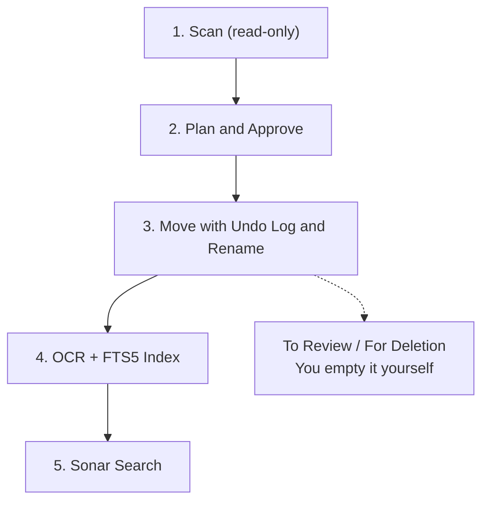

# Personal File Organization Kit

A complete, shareable recipe for turning a messy Windows PC (Desktop, Downloads, Documents, old backups, external drives) into a tidy, searchable family filing cabinet, built and maintained by an AI coding agent. Works with any agent that can run shell commands on your PC: Codex, Claude Code, Grok, Cursor, or similar.

> All names, companies, and paths in this kit are placeholders. Replace `<You>`, `<Spouse>`, `<Kid1>`, `<Kid2>`, `<Parents>`, `<Employer>`, `<Bank>`, `<Brokerage>` with your own.

## How it works

The kit is a five-stage pipeline. Every stage runs locally on your PC. Nothing is ever permanently deleted, and a file is never overwritten.



1. **Scan (read-only).** The agent inventories Desktop, Downloads, Documents, and any backups or external drives you point it at. It reads names, types, hashes, and page 1 of documents. It does not move anything yet.
2. **Plan and approve.** Every proposed move or rename is written to a plan (a manifest CSV) and shown to you with counts, samples, and a recommendation. You approve before anything is applied. Unattended bulk runs (old backups or an external drive) still write a plan and an undo log.
3. **Move with an undo log, and rename.** Approved plans are applied in PowerShell, without `-Force`. On a collision the file is skipped and reported. Exact SHA-256 duplicates and junk go to `To Review\For Deletion` — you empty that folder yourself. Every applied move is recorded in an undo log so it can be reversed.
4. **OCR and FTS5 index.** Scanned PDFs get a searchable text layer (the untouched original is kept in `To Review\OCR Originals`). Then a local SQLite FTS5 index is built from file names, paths, and the text inside PDFs, Word, Excel, PowerPoint, and text files. Nothing is uploaded.
5. **Sonar search.** Search the cabinet from a small desktop app (`scripts\sonar_app.pyw`) or the terminal (`python scripts\sonar.py "<words>"`). Sonar can also sort a folder with preview, apply, and undo, and flag IDs that are about to expire. If you keep a second index for an external drive, add it to `extra_indexes` in `config.json`: the Source dropdown (All drives, plus each labeled index) and `--source all|local|external` search one or every index, including an offline copy when the drive is unplugged.

**Getting started.** [GETTING_STARTED.md](GETTING_STARTED.md) is the short walkthrough for both paths:

- **You cloned this repo.** Follow that file (or the quick start below) and open the folder in Cursor, Claude Code, Codex, or a similar agent so `AGENTS.md` / `CLAUDE.md` are picked up automatically. The scripts in `scripts\` are already here.
- **You don't want to clone anything.** Download just [GETTING_STARTED.md](GETTING_STARTED.md), upload or paste it into ChatGPT, Claude, Gemini, Cursor, or any other LLM, and follow the starter prompt inside it.

## Quick start with this repo

This repo already contains the finished scripts (`scripts\`) and agent rules (`AGENTS.md`, `CLAUDE.md`, `.cursor\rules\agents.mdc`), so you can skip most of Prompt A. For a fuller walkthrough, including a copy-paste prompt you can use without cloning, see [GETTING_STARTED.md](GETTING_STARTED.md).

1. Install the prerequisites in [section 6](#6-prerequisites-and-install-windows), then run `python -m pip install -r requirements.txt`.
2. Clone or copy the repo to a project folder, e.g. `%USERPROFILE%\Documents\Projects\file-organizer-kit`.
3. Copy `config.example.json` to `config.json` and edit it: your cabinet root, your people tokens (`You`, `Spouse`, `Kid1` …) and their nicknames, and the `75 <You>` folder name. `config.json` is git-ignored, so your details never get committed.
4. Open the folder in your agent (Cursor, Codex, Claude Code, Grok …). It reads `AGENTS.md` automatically. Ask it to "run Prompt A, but the scripts already exist: create the cabinet folders, the plans files and the shortcuts, then run the tests in Part 4."
5. Build the index once with `python scripts\sonar_index.py index`, then search with `python scripts\sonar.py "<words>"` or open `scripts\sonar_app.pyw`.

Everything the scripts write (index, plans, undo logs) is git-ignored. Never commit `config.json`, `_index\` or `plans\`.

## Contents

- [How it works](#how-it-works)
- [Quick start with this repo](#quick-start-with-this-repo)
- [GETTING_STARTED.md](GETTING_STARTED.md) — walkthrough and paste-into-any-LLM prompt

1. [What this is](#1-what-this-is)
2. [Principles](#2-principles)
3. [Folder structure template](#3-folder-structure-template)
4. [Recommended naming convention](#4-recommended-naming-convention)
5. [Lessons learned](#5-lessons-learned)
6. [Prerequisites and install (Windows)](#6-prerequisites-and-install-windows)
7. [Project layout](#7-project-layout)
8. [Prompt A: master build prompt](#8-prompt-a-master-build-prompt)
9. [Prompt B: per-folder session prompt](#9-prompt-b-per-folder-session-prompt)
10. [Prompt C: unattended bulk prompt](#10-prompt-c-unattended-bulk-prompt-old-backup-or-external-drive)
11. [Daily use](#11-daily-use)
12. [Automating backups to an external drive](#12-automating-backups-to-an-external-drive)
13. [Troubleshooting](#13-troubleshooting)

---

## 1. What this is

This kit describes a local-only system, with no cloud uploads, for organizing every personal document a household owns. An AI agent sorts files into a numbered "cabinet" of folders, renames them to a predictable standard, OCRs scanned PDFs so their text can be searched, and builds a full-text index you can search from a small desktop app or the terminal. Nothing is ever permanently deleted. Anything that looks like junk or a duplicate goes to a review folder, and you empty it yourself. The agent works in logged, reversible sessions. It handles the rule-following work and leaves only real judgment calls for you, grouped and with a recommendation for each.

**What you get**

| Piece | What it does |
|---|---|
| Folder cabinet | `00 Inbox` … `80 Photos`, one numbered "drawer" per life area, with per-person subfolders |
| Naming standard | `Person_Type_Date_Detail`, ID expiry dates (`EXP_YYYY-MM-DD`) in the name, Money files sorted by date |
| Safe dedupe | SHA-256 exact matches only, moved to `To Review\For Deletion`, never deleted |
| OCR | Scanned PDFs get a text layer (OCRmyPDF), with untouched originals kept in `To Review\OCR Originals` |
| Local index | SQLite FTS5 index of names, paths and document text (PDF, Word, Excel, PowerPoint, text) |
| Search app | Desktop window with Search, Sort a folder and Expiring tabs, filters and a preview pane |
| `sonar` / `ssort` | Terminal search with clickable results, and a "sort this folder" tool with preview/apply/undo |
| Audit | Checks every name against the standard and flags copies, vague names, `EXP_5555` and duplicates |
| Agent protocol | Locks, session logs, STATUS board and ISSUES list. Runs unattended and logs issues for your review |
| External backup | `scripts\sonar_backup.py` copies new cabinet files to an external drive by SHA-256, never overwrites or deletes |

---

## 2. Principles

1. **Never delete.** "Delete" always means *move to* `To Review\For Deletion\...`. You empty it yourself after a look.
2. **Dry run, then apply.** Every move or rename is first written as a plan (CSV) and shown. It's applied only after you approve, or, for unattended runs, it's applied with an undo log.
3. **Undo logs for everything.** Every applied move or rename writes `source,dest,timestamp` to an undo CSV, and an undo script reverses it.
4. **Never overwrite.** Check that the target is free before each move. On a collision, skip and log. Never `Move-Item -Force`.
5. **Skip shortcuts and system files:** `.lnk`, `desktop.ini`, `thumbs.db`, `~$` temp files, `System Volume Information`, `$RECYCLE.BIN`, `FOUND.000`.
6. **Hash before calling anything a duplicate.** Only exact SHA-256 matches count. The same name or a similar size proves nothing.
7. **Never rename code or projects.** Move code, project folders and app bundles whole.
8. **Make small reversible calls yourself, and ask only about judgment calls.** Group those calls by folder or type (not one per file), each with a recommendation and an `Invoke-Item "<path>"` command so the human can open the file in one step.
9. **Recommend, don't just ask.** Every flag comes with a proposed name or destination and the reason for it.
10. **Done means verified.** A session is only done when the audit is clean (or only needs-human items remain), the session log is written, STATUS is updated and the lock is released.

---

## 3. Folder structure template

The cabinet root is `%USERPROFILE%\Documents\Family`. The review area sits *outside* the cabinet at `%USERPROFILE%\Documents\To Review`. The top-level folders are fixed. The subfolders shown are generic examples: the agent scans your files, starts from these examples, adds or drops subfolders to fit what you actually own, and creates them only after you approve.

```
%USERPROFILE%\Documents\Family
├── 00 Inbox
├── 10 Identity
│   ├── IDs
│   ├── Passports
│   ├── Insurance Cards
│   └── _Emergency
├── 15 Travel
│   ├── <YYYY>
│   └── Trip Ideas
├── 20 Health
│   ├── <You>
│   ├── <Spouse>
│   ├── <Kid1>
│   └── <Kid2>
├── 30 Home
│   ├── Property
│   ├── Mortgage
│   ├── Bills and Utilities
│   ├── Vehicles
│   ├── Insurance and Warranties
│   ├── Manuals
│   └── Projects
├── 40 Money
│   ├── Taxes
│   │   └── <YYYY>_Tax
│   ├── Banking
│   ├── Investments
│   ├── Retirement
│   ├── Receipts
│   └── Budget
├── 50 Legal
│   ├── Estate Planning
│   ├── Contracts
│   └── Leases
├── 60 Work
│   ├── Career
│   ├── Employers
│   │   └── <Employer>
│   │       └── Payslips
│   │           └── <YYYY>
│   └── Job Search
├── 65 Learning
│   └── <Course or Subject>
├── 70 Kids
│   ├── <Kid1>
│   │   └── <Kid1>_School
│   └── <Kid2>
│       └── <Kid2>_School
├── 75 <You>
│   └── Miscellaneous Personal Docs
├── 80 Photos
│   └── <YYYY>_Photos
├── _index          ← index.db lives here (tooling, never organized)
└── README.md       ← your folder list + naming convention (source of truth)

%USERPROFILE%\Documents\To Review
├── For Deletion
└── OCR Originals
```

The subfolders above are common starting examples, not a fixed list. The agent keeps the ones you need, drops the empty ones, and suggests others based on what it finds in your files.

**What goes where, and how to subdivide it**

| Folder | What typically goes here | How to subdivide |
|---|---|---|
| `00 Inbox` | Anything not filed yet: new downloads, scans, files the agent wasn't sure about | No subfolders, except a temporary one per bulk import (e.g. `00 Inbox\<old-backup-name>`). Names stay as they arrived until filed |
| `10 Identity` | IDs, passports, birth certificates, insurance cards, an emergency info sheet | By document type: `IDs`, `Passports`, `Insurance`, `_Emergency`. Put the person in the filename, not in a folder |
| `15 Travel` | Itineraries, bookings, travel insurance, trip ideas | A flat year folder (`15 Travel\<YYYY>`) plus `Trip Ideas`. Undated ideas stay in `Trip Ideas` |
| `20 Health` | Doctor, dental, vision, pharmacy and lab records, explanation-of-benefits statements | One subfolder per person: `<You>`, `<Spouse>`, `<Kid1>`, `<Kid2>`, `<Parents>` |
| `30 Home` | Property papers, mortgage statements and payoff letters, bills and utilities, vehicles, warranties, manuals, home projects | By topic: `Property`, `Mortgage` (one folder for the loan, statements named by date; a refinance gets its own `Mortgage\<Lender>_<YYYY>`), `Bills and Utilities`, `Vehicles`, `Insurance and Warranties`, `Manuals`, `Projects\<ProjectName_Year>` |
| `40 Money` | Tax returns and forms, bank and brokerage statements, retirement accounts, receipts, budgets | Taxes by year (`Taxes\<YYYY>_Tax`), `Banking\<Bank>`, `Investments\<Brokerage>`, `Retirement`, `Receipts`, `Budget` |
| `50 Legal` | Wills and other estate planning documents, contracts, leases, agreements | By topic: `Estate Planning`, `Contracts`, `Leases`. Keep it shallow |
| `60 Work` | Resumes, certifications, offer letters, reviews, payslips, work projects | `Career`, `Employers\<Employer>`, and payslips under `Employers\<Employer>\Payslips\<YYYY>` (by year, under Work — not under Money). `Job search` is optional and excluded from renaming; `Projects` is for work-project files, not code repos |
| `65 Learning` | Courses, books, study notes, certificates in progress | One subfolder per course or subject. Skipped by OCR |
| `70 Kids` | School records, report cards, activity forms | One subfolder per child with a single `<KidN>_School` folder inside. No tiny folders like "Homework" |
| `75 <You>` | Your own papers that don't fit another drawer: school diplomas and transcripts, certificates, memberships, hobby and personal project files, letters and keepsakes | Start with one `Miscellaneous Personal Docs` folder. Split out a topic folder only once it has enough files to justify it |
| `80 Photos` | Photos and scans of photos | By year with a topic word (`2025_Photos`, never just `2025`). Skipped by OCR |
| `To Review\For Deletion` | Exact duplicates, installers, temp files, junk. **Nothing is ever deleted by the agent** | One subfolder per reason: `<folder> duplicates`, `Downloads junk`, `already-on-PC`. Relative paths are preserved |
| `To Review\OCR Originals` | Untouched copies of PDFs from before OCR | Mirrors the cabinet paths. Clear it once you're happy with the OCR results |

**Structure rules**
- **Documents that never change get one folder; documents that repeat get a folder per year.** IDs, passports, birth certificates, a property deed or a will are one-time or rarely updated, so each type lives in a single folder and the newest version is easy to find (`10 Identity\Passports`). Taxes, statements, receipts, trips and payslips come every year, so they're grouped by year (`40 Money\Taxes\2025_Tax`, `15 Travel\2025`, `60 Work\Employers\<Employer>\Payslips\2025`), which keeps each year's packet together and lets you archive old years in one move. Travel uses a bare year because the parent folder already names the topic; payslips do the same under the `Payslips` folder. When in doubt, ask: will I get a new one of these next year? If yes, organize by year; if no, keep it in one folder.
- Number the drawers (`00`, `10`, `15` …) so they always sort in the same order. The gaps leave room to add drawers later (e.g. `76 <Parents>` if you manage a parent's papers, or `90 Archive` for old files you want to keep).
- A folder is a packet you grab, not a person, so the person goes in the filename. Per-person subfolders exist only where a drawer is mostly per-person (Health, Kids).
- Add deeper subfolders only where they do real work (tax years, per-institution statements, per-project). Don't create a folder for three files.
- A subfolder name always needs a topic word. Never use a bare year, except under `15 Travel`, where the parent folder is the topic (`15 Travel\2025`, not `2025_Trips`). Photos still use `2025_Photos`.
- Never file email, passwords or live login details in the cabinet.
- Keep active code and git repos in a separate Projects folder outside the document cabinet so build artifacts and `.git` folders don't bloat OCR and search indexes.

---

## 4. Recommended naming convention

One consistent pattern per category lets you find a file by its name alone, makes it sort correctly in Explorer, and lets the audit check every name automatically.

**Formatting rules (apply to every category)**
- Dates are always `YYYY-MM-DD`. Use `YYYY-MM` or `YYYY` only when that's all the document gives you.
- Use underscores `_` **between** parts and hyphens `-` **within** a part: `KitchenRemodel_Quote_2026-03-04_Contractor-A.pdf`.
- No spaces, and lowercase extensions (`.pdf`, `.jpg`).
- Person and project tokens are CamelCase with no separators (`Kid1`, `KitchenRemodel`).
- Never use `Copy`, `- Copy`, `Old`, `_old`, `(1)`, `.bak`, `final`, `v2` or `Draft2`. If two genuinely different files would get the same name, add a meaningful word instead: `Filed-Scan`, `PriorFormat`, `OriginalResolution`, `Signed`.
- Use straight apostrophes only (`'`, not `’` or `‘`). Better still, leave apostrophes out.
- The date comes from the filename or page 1 of the document. It's never the file's modified date, and never a scanner prefix like `04192026_` (that's when it was scanned).

**Why the parts are ordered this way**
- **Person first** in personal drawers (`<Kid1>_Dental_…`). Explorer groups each person's files together, and typing the name in search narrows results right away.
- **Date first** in Money (`2026-02-21_<Bank>_Statement…`). Money is usually looked up by when it happened, and `YYYY-MM-DD` at the front sorts in time order automatically.
- **Tax year first** in tax files (`2025_Tax_…`). A whole tax year sorts together, ready to hand to a preparer.
- **Expiry last** on IDs (`…_EXP_2030-01-31`). The `Expiring` tab and `sonar --expiring` read it, and it's always in the same place.
- **Type before detail.** The broad category (Dental, Statement, Quote) comes before the specifics (provider, item), so similar documents sort together.
- The indexer also splits names into words (`KitchenRemodel_Quote` becomes "kitchen remodel quote"), so every part of a name is searchable.

**Pattern and examples per category**

| Category | Pattern | Examples |
|---|---|---|
| Person documents (Health, Kids, Travel, Legal, `75 <You>`) | `Person_Type_Date_Detail.ext` (no date: `Person_Type_Detail.ext`) | `Kid1_Dental_2026-10-01_Checkup.pdf`<br>`Spouse_Lab_2025-11-03_BloodWork.pdf`<br>`Kid2_School_2026-09-01_ReportCard.pdf` |
| IDs and passports | `Person_DocumentType_EXP_YYYY-MM-DD.ext` (expiry always last; underscores between parts, hyphens only inside the ISO date) | `You_DL_EXP_2030-01-31.pdf`<br>`Kid2_Passport_EXP_2031-03-18.pdf`<br>`Spouse_DL_EXP_5555.jpg` (only if the expiry is truly unreadable) |
| Docs that never expire | `Person_DocumentType.ext` (no `EXP` token) | `Kid1_BirthCertificate.pdf`<br>`You_SocialSecurityCard.pdf` |
| Insurance cards | `Person_Carrier_Side.ext` | `You_<Insurer>_Front.png`<br>`Kid1_<Insurer>_Back.png` |
| Portrait photos | `Person_PhotoType_NN.ext` | `Kid2_PassportPhoto_01.jpg`<br>`You_Headshot_02.jpg` |
| Dated photos (80 Photos) | `Person_Photo_YYYY-MM-DD_Detail.ext` | `Kid1_Photo_2026-04-09_Birthday.jpg`<br>`Family_Photo_2025-07-04_Beach.jpg` |
| Home (no person) | `Project_Type_Date_Detail.ext` | `Home_Deed_2020-03-15.pdf`<br>`KitchenRemodel_Quote_2026-03-04_Contractor-A.pdf`<br>`Car_Registration_2026-05-01.pdf` |
| Money | `YYYY-MM-DD_Source_DocType_Detail.ext` (no person) | `2026-02-21_<Bank>_Statement.pdf`<br>`2026-03-10_<Brokerage>_TradeConfirm.pdf`<br>`2026-01-15_Utility_Bill_Electric.pdf` |
| Tax | `YYYY_Tax_Form_Source.ext` | `2025_Tax_1098_<Bank>.pdf`<br>`2025_Tax_W2_<Employer>.pdf`<br>`2025_Tax_Return_Federal.pdf` |
| Work | `Person_Type_Date_Detail.ext` or `<Employer>_Type_Date.ext` | `You_Resume_2025-11-10.pdf`<br>`<Employer>_OfferLetter_2025-01-15.pdf`<br>`<Employer>_Payslip_2026-01-15.pdf` (filed in `Employers\<Employer>\Payslips\2026`) |
| Tools, templates, research | `Topic_Type_Detail.ext` | `Budget_Template_Annual.xlsx`<br>`Mortgage_Calculator_Refinance.xlsx` |
| `00 Inbox` | Leave the name as it arrived | — |

**Never rename**
- Code and app files (`.py .js .ts .tsx .html .css .json .ps1 …`), dashboards and project folders. Move them whole.
- `60 Work\Job search` (optional; many people prefer to thin it themselves).
- Your own camera-roll photos, if you'd rather thin them yourself (optional).
- Saved-web-page `*_files` asset folders (the page breaks).
- Generated output (transcripts, audio, slide images, logs) and export bundles left as they arrived.

These go in `plans\check-exceptions.txt` (see §7) so the audit doesn't flag them.

---

## 5. Lessons learned

These are corrections from a real multi-week cleanup. Put all of them in the agent's rules.

**Naming and dates**
- Use `EXP_5555` only when an ID that has an expiry is truly unreadable. Never invent an expiry date. Docs that don't expire get no `EXP` token.
- A scanner date prefix is not a document date. The file's modified time is not a document date either.
- If there's no readable document date, keep the original name and log a grouped needs-human issue. Don't guess.
- Read page 1 before assigning a person. Memory is wrong more often than you'd think. A vital record "everyone knew" was one kid's turned out to belong to the other.

**Copy-token traps**
- `Copy`, `_old`, `(1)` and `- Copy` mark duplicates for the audit. Don't leave them in keeper names.
- `X_Filed.pdf` and `X_Filed-Copy.pdf` turned out to be *different* files (different size and hash). Check that the target doesn't exist before every rename. If both files are real, keep both under distinct names.

**Duplicates and thinning**
- SHA-256 before calling anything a duplicate. Archive wrappers (`.7z` / `.zip`) and overlapping extracts can share names without being byte-identical.
- Same-day receipts with `-b` / `-c` suffixes are separate transactions. Don't thin receipts.
- Never auto-thin drafts, near-copies or "looks similar" sets. Only exact hash matches go to For Deletion, unless the human names a specific file.
- Keep one canonical copy of a course or library. If a tracker spreadsheet maps those files, update it in the same session as any rename (every row has a file, every file has a row).

**Filenames, backups and generated output**
- Normalize curly apostrophes (`’` `‘`) to straight `'` in filenames.
- Backups of edited scripts or docs go in `plans\` with a timestamp, **never** next to the original. `.bak` files beside originals create audit noise.
- Generated output (transcripts, audio, slide images, logs) gets a `prefix:` exception. Never mass-rename it.
- Add exceptions only for standing exclusions the human has approved, never to hide unfinished work.

**Locked files and encoding**
- A file that's open in a PDF viewer or Office can't be moved ("Access Denied"). Log it as skipped/locked and move on. Don't retry in a loop. A failed apply that leaves a header-only undo log must not be used for undo.
- Windows PowerShell 5.1 reads scripts as ANSI unless they're saved as **UTF-8 with BOM**. Any script containing non-ASCII characters (curly quotes, en dashes, accented names) needs the BOM. Markdown docs can stay plain UTF-8.

**Session hygiene**
- Never report done until the audit has run, the session log is written, STATUS is updated and the lock is released. Agents like to say "done" early. The protocol makes them prove it.
- At the start of a session, reconcile ISSUES and STATUS with the disk and undo logs. The human or another tool may have changed things in between.
- Group needs-human issues by folder or type, each with a recommendation and `Invoke-Item` commands.
- Don't move files into a folder another session has locked.
- If an undo-log timestamp would collide, add a suffix (`-2`). Never overwrite another session's log.
- When the folder tree changes, update `Family\README.md` (back it up to `plans\` first).

**Respect the human's choices**
- Files the human already deleted (in the Recycle Bin, or missing with no undo record) were deleted on purpose. Never restore them.
- Leave one-off files you can't identify as they are and add a `name:` exception rather than guessing a type or date.

**OCR**
- Skip `65 Learning` (books) and `80 Photos`. Skip `60 Work` too unless the human asks for it.
- Always keep the untouched original in `To Review\OCR Originals`, with its relative path preserved.
- Re-index after OCR. Don't claim that content search works until the index actually stores the extracted text.

**Agent behavior**
- Agents sometimes stop to ask "Want me to continue?". For unattended runs, forbid that explicitly (see §10).
- Agents can't see what another app on your desktop is doing. Have them work through files on disk (STATUS.md, ISSUES.csv, session logs) so any agent can pick up where another left off.

---

## 6. Prerequisites and install (Windows)

Open **PowerShell** (Windows Terminal or any terminal running a PowerShell tab) and run:

```powershell
# Python 3.11+ (3.12 recommended). Tick "Add python.exe to PATH" if using the python.org installer.
winget install -e --id Python.Python.3.12

# Tesseract OCR engine (UB Mannheim build)
winget install -e --id UB-Mannheim.TesseractOCR

# Ghostscript (OCRmyPDF needs it; also a fallback PDF renderer)
winget install -e --id ArtifexSoftware.GhostScript

# Optional: Git, to version the project scripts
winget install -e --id Git.Git
```

If `winget` isn't available, download the installers manually: python.org, the UB Mannheim Tesseract page (github.com/UB-Mannheim/tesseract/wiki) and ghostscript.com.

**Add Tesseract and Ghostscript to PATH** if the installers didn't. Typical folders:
- `C:\Program Files\Tesseract-OCR`
- `C:\Program Files\gs\gs<version>\bin`

Settings → System → About → Advanced system settings → Environment Variables → Path → New. Then **close and reopen** the terminal.

**Python packages**

```powershell
python -m pip install --upgrade pip
python -m pip install ocrmypdf pymupdf pypdf pillow python-docx openpyxl python-pptx
# optional: preview iPhone HEIC photos
python -m pip install pillow-heif
```

**Verify**

```powershell
python --version                 # 3.11 or newer
tesseract --version
gswin64c -version
ocrmypdf --version
python -c "import fitz, pypdf, docx, openpyxl, pptx, PIL; print('python libs OK')"
python -c "import sqlite3; c=sqlite3.connect(':memory:'); c.execute('create virtual table t using fts5(x)'); print('FTS5 OK')"
```

**Gotchas**
- **PowerShell 5.1 and UTF-8:** save `.ps1` files that contain any non-ASCII character as *UTF-8 with BOM*, or 5.1 garbles them. PowerShell 7 (`winget install Microsoft.PowerShell`) doesn't have this problem.
- **`Invoke-Item` needs a PowerShell tab.** If you use Warp, Windows Terminal or VS Code, make sure the tab is PowerShell, not cmd or WSL, or the review commands won't open files.
- **Execution policy:** if scripts won't run, use `Set-ExecutionPolicy -Scope CurrentUser RemoteSigned`.
- **Sleep:** for overnight runs, set Settings → System → Power → Sleep to **Never** while plugged in.
- **Agent approval prompts:** most agents ask before each shell command. For attended sessions that's your safety gate. For unattended runs use a tool or mode that can loop on its own, and rely on the undo logs.

---

## 7. Project layout

The project folder holds the scripts, rules and logs. It is **not** the cabinet itself.

```
%USERPROFILE%\Documents\Projects\file-organizer-kit
├── GETTING_STARTED.md         walkthrough + paste-into-any-LLM prompt
├── README.md                  full guide
├── config.example.json        settings template: copy to config.json (git-ignored) and edit
├── requirements.txt           Python packages
├── AGENTS.md / CLAUDE.md / .cursor\rules\*.mdc   ← agent rules (use whichever your tool reads)
│     file-naming        naming standard + process
│     file-moves         move safety rules
│     session-protocol   start / self-review / definition of done / finish
│     lessons-learned    §5 of this kit
├── scripts
│   ├── organize.ps1           simple folder-to-folder mover (dry-run default, -Apply)
│   ├── apply-manifest.ps1     apply a Source,Dest CSV (dry-run default, -Apply) + undo log
│   ├── undo-manifest.ps1      reverse an undo log (dry-run default, -Apply)
│   ├── check.ps1              audit one cabinet folder (calls sonar_index.py audit)
│   ├── sonar_index.py         indexer + search + audit (reads config.json)
│   ├── sonar_ocr.py           OCR plan/apply
│   ├── sonar.py               terminal search (sonar)
│   ├── sonar_app.pyw          desktop app
│   ├── sonar_preview.py       preview renderer for the app
│   ├── sonar_sort.py          sort engine (ssort)
│   ├── sonar_sort_rules.json  editable sort rules
│   └── sonar_backup.py        additive hash-dedup backup to an external drive (dry-run default)
├── plans
│   ├── STATUS.md              one line per cabinet folder: state, latest undo log, open issues
│   ├── ISSUES.csv             issue tracker (columns below)
│   ├── check-exceptions.txt   audit exclusions
│   ├── locks\                 <folder-slug>.lock while a session works a folder
│   ├── sessions\              YYYYMMDD-HHMMSS-<folder-slug>.json session logs
│   ├── sort-plans\            ssort preview plans
│   ├── *-manifest.csv         rename/move plans (Source,Dest,Group,Reason,DateSource)
│   └── undo-log-*.csv         every applied move
└── NOTES.md                   standing preferences + decisions log (human-readable memory)
```

**`plans\ISSUES.csv` columns**

```
"id","folder","path","problem","proposed_fix","status","owner","opened","closed"
```
- `id`: `ISS-001`, `ISS-002` …
- `status`: `open` (the agent can fix it under the rules), `needs-human` (a judgment call), `closed`
- `owner`: `agent` or `human`
- `proposed_fix`: always a recommendation, plus `Invoke-Item "<full path>"` for needs-human rows

**`plans\STATUS.md` example**

```
# Cabinet status. Last updated 2026-01-10 09:15 (local)
| Folder | State | Latest undo log | Open issues |
|---|---|---|---|
| 10 Identity | done | plans\undo-log-20260110-091200.csv | 0 |
| 40 Money | needs-human | plans\undo-log-20260109-221500.csv | 3 |
| 30 Home | not started | — | — |
```

**`plans\check-exceptions.txt` format**

```
# Audit exclusions. One per line; blank lines and # comments ignored.
#   prefix:<path relative to cabinet root>   skip anything under this prefix
#   name:<substring>                          skip if file name contains this (case-insensitive)
#   glob:<wildcard>                           skip if relative path matches
#   kind:code                                 skip code/script extensions (default; documentation)
prefix:60 Work\Job search
prefix:65 Learning\<Course>\Study
name:unknown-receipt-700.pdf
kind:code
```

**Session log schema** (`plans\sessions\YYYYMMDD-HHMMSS-<slug>.json`)

```json
{
  "session_id": "string",
  "folder": "40 Money",
  "started": "2026-01-10T09:00:00-05:00",
  "ended": "2026-01-10T09:40:00-05:00",
  "counts": {"renamed": 0, "moved": 0, "skipped": 0, "held": 0, "errors": 0},
  "undo_log": "plans\\undo-log-....csv or null",
  "held_files": [{"path": "...", "reason": "..."}],
  "issues_opened": ["ISS-012"],
  "issues_closed": ["ISS-007"],
  "check_summary": "0 nonconforming, 0 copy-pattern, 1 needs-human",
  "notes": "string"
}
```

---

## 8. Prompt A: master build prompt

If you cloned this repo, you already have the scripts. Follow [GETTING_STARTED.md](GETTING_STARTED.md) (or the quick start above) and ask your agent to create the cabinet folders, plans files, and shortcuts, then run the tests. You do not need to paste a long build prompt.

If you are starting from an empty folder without cloning, [GETTING_STARTED.md](GETTING_STARTED.md) has a short starter prompt you can paste into any LLM. Have the agent build the rules, scripts, cabinet folders, and shortcuts only — it should not move, rename, or OCR your real files in that first build.

Fill in your household details first: cabinet and review roots, people tokens (`You`, `Spouse`, `Kid1`, `Kid2`, `Parents`) and aliases, and your time zone.

---

## 9. Prompt B: per-folder session prompt

Use this for each folder you clean, attended and with approvals. The short version, once the rules exist:

```text
Run the session protocol for <folder>. Loop until Definition of done or only needs-human items remain.
```

The session should reconcile `plans\STATUS.md` and `plans\ISSUES.csv` with the disk, claim a lock, scan (skip `.lnk` and `desktop.ini`), write a rename/move manifest, get your approval, apply it with an undo log (no overwrites), and finish with check / STATUS / session log / lock release. Full wording lives in [GETTING_STARTED.md](GETTING_STARTED.md) and the session-protocol rule.

---

## 10. Prompt C: unattended bulk prompt (old backup or external drive)

Use this for a big, hands-off job, such as an old-PC backup folder or an external drive. It runs overnight, applies everything with undo logs instead of pausing, and leaves a single list of open items for the morning.

**Before you start:** plug in the drive, set the PC to never sleep, close any open PDFs or Office files from that drive, and make sure your agent can run commands without a per-command approval prompt for this session (otherwise it stalls the moment you walk away).

**Safer variant:** for a drive nobody has looked at yet, first run it with *"PLAN ONLY: no moves, renames or OCR. Write the plan CSV and issues, then stop"*. Review the plan in the morning, then run it again without that line.

Tell the agent the source path, approve that area, and have it organize into `<DRIVE>:\Family` using the same folder structure and naming standard as your cabinet. Everything stays on that drive (do not copy into `C:`). Keep the usual rules: never delete, never overwrite, log judgment calls to `plans\ISSUES.csv` as needs-human, and do not stop until the definition of done is met. The longer paste-in wording is in [GETTING_STARTED.md](GETTING_STARTED.md).

This organizes files *already on* the external drive. To copy new cabinet files *to* a drive without overwriting anything already there, use [section 12](#12-automating-backups-to-an-external-drive).

---

## 11. Daily use

**The search tool at a glance**
- **`sonar` (terminal):** searches file names, folder paths and the text inside documents, including OCR'd scans. Results are ranked, show the matching line, and each filename is a clickable link (Ctrl+click opens it in Windows Terminal or Warp). Filters: `--folder`, `--person`, `--type`, `--from` / `--to`. `sonar --expiring` lists IDs by expiry date, and `sonar --reindex` refreshes the index.
- **Sonar app (desktop shortcut):**
  - **Search tab:** a search box, a Source dropdown (All drives, plus any indexes in `extra_indexes`), and Folder, Person, Type and date-range filters. Results show which drive they came from. If a file lives on an unplugged drive, the preview tells you to plug it in instead of erroring. A preview pane on the right shows a PDF page (Prev/Next), an image, the first lines of a text or CSV file, or the text of a Word or Excel file.
  - **Sort a folder tab:** pick a folder, preview where each file would go, tick and apply, and undo the last sort if needed.
  - **Expiring tab:** every ID with an `EXP_` date (the older `Exp-YYYY-MM-DD` form is still read), soonest first.
- **`ssort` (terminal):** the same sort engine as the app tab. Preview → apply → undo.


| Task | Command |
|---|---|
| Search names + contents | `sonar "property tax"`, `sonar passport -n 50` |
| Search one or every drive | `sonar "property tax" --source all`, `sonar passport --source external` |
| Exact phrase / OR / exclude / prefix | `sonar '"policy number"'`, `sonar w2 OR 1099`, `sonar insurance -auto`, `sonar remod*` |
| Filters | `sonar dental --person <Kid1>`, `sonar statement --folder "40 Money" --from 2025-01-01 --to 2025-12-31 --type PDF`, `sonar kindle --type eBooks` |
| Expiring IDs (next 180 days + overdue) | `sonar --expiring` or `sonar --expiring --days 365` |
| Re-index after changes | `sonar --reindex` (or the app's Refresh button) |
| Sort a messy folder | `ssort "$env:USERPROFILE\Downloads"` → review → `ssort --apply <plan.csv>` |
| Undo a sort | `ssort --undo plans\undo-log-sort-<stamp>.csv` |
| Audit a drawer | `.\scripts\check.ps1 -Folder "40 Money"` |
| OCR new scans | `python scripts\sonar_ocr.py plan --folder "00 Inbox"`, then `apply --folder "00 Inbox" --yes`, then `sonar --reindex` |
| Open the app | Desktop shortcut **Sonar** |
| Back up new cabinet files to an external drive | `python scripts\sonar_backup.py` (dry-run), then `--apply`. See [section 12](#12-automating-backups-to-an-external-drive) |

**In the app:** type and press Enter. The arrow keys move through results and the preview updates. Double-click opens a file. Right-click gives Open folder or Copy path. **Sort a folder** previews a plan with checkboxes, and **Apply** and **Undo last** are one click each. **Expiring** shows IDs that are due soon.

**New files:** drop anything into `00 Inbox`. Every week or so, run `ssort` on Inbox and Downloads, or a quick Prompt B session.

**Reviewing For Deletion (your job, not the agent's):**
1. Open `To Review\For Deletion`. Each subfolder says why the files are there (`<folder> duplicates`, `Downloads junk`, `already-on-PC`).
2. Spot-check a few files. Duplicates have a keeper at the path recorded in the undo log.
3. When you're satisfied, delete the subfolder yourself (or move it to the Recycle Bin).
4. Do the same with `To Review\OCR Originals` once you've confirmed that the OCR'd PDFs look right.

**Expiry watch:** IDs carry `EXP_YYYY-MM-DD`, so `sonar --expiring` (or a monthly reminder from any scheduler or assistant) catches passports and licenses before they lapse.

---

## 12. Automating backups to an external drive

`scripts\sonar_backup.py` copies **new** cabinet files to an external drive. It is additive: it never deletes anything on the destination, and it never overwrites a file that is already there.

- **Dry-run by default.** It only plans and writes a CSV log under `plans\`. Pass `--apply` to copy.
- **Pre-backup re-index (default).** Step 1 incrementally re-indexes both the local cabinet and the external drive *before* hashes are read or files are planned, so a stale index cannot cause false copies or missed deduplication. If the external drive is not connected, the script exits before attempting to index it. After a successful destination re-index, an optional `backup.offline_index` (a local copy of the destination index, used when the drive is unplugged) is refreshed if configured.
- **Hash dedupe.** Each source file is hashed with SHA-256 and checked against the destination index (default: `<external>\_index\index.db`, or `backup.index_db`). If that exact hash already exists *anywhere* on the destination, the file is skipped.
- **Same-path conflicts.** If the destination already has a file at the same relative path with a *different* hash, the incoming file is copied to `To Review\Sync Conflicts\` (or `backup.conflicts_root`) instead of overwriting. If that conflict path is already taken, a `-2`, `-3`, … suffix is added. Nothing already on the drive is changed.
- **Skipped names.** `_index` folders, `.lnk` shortcuts, and `desktop.ini` are not copied.

**Configure it** by copying the `_backup_example` block in `config.example.json` to a `backup` object in your git-ignored `config.json`:

```json
"backup": {
  "dest_root": "<external>\\Family",
  "index_db": "<external>\\_index\\index.db",
  "conflicts_root": "<external>\\To Review\\Sync Conflicts",
  "offline_index": "%USERPROFILE%\\Documents\\Family\\_index\\external.db"
}
```

`offline_index` is optional. The source defaults to `cabinet_root`. You can also pass the paths on the command line.

```
python scripts\sonar_backup.py
python scripts\sonar_backup.py --skip-pre-reindex
python scripts\sonar_backup.py --skip-local-reindex
python scripts\sonar_backup.py --skip-external-reindex
python scripts\sonar_backup.py --apply
python scripts\sonar_backup.py --apply --reindex
python scripts\sonar_backup.py --dest "<external>\Family" --index "<external>\_index\index.db"
```

- `--skip-pre-reindex` skips the pre-backup re-index of both the Local Drive and the External Drive (useful for a fast dry-run when you know both indexes are already fresh).
- `--skip-local-reindex` skips only the Local Drive pre-reindex.
- `--skip-external-reindex` skips only the External Drive pre-reindex.
- `--reindex` refreshes the destination index *after* a successful apply so later runs see the files just copied, and updates `backup.offline_index` if set.

The CSV log records every `WOULD_COPY`, `COPY`, `SKIP`, `CONFLICT`, or `ERROR` with source, destination, and hash.

If the destination index does not exist yet, the pre-backup re-index will create it. You can also build it once yourself with `python scripts\sonar_index.py --db "<external>\_index\index.db" index --root "<external>\Family"`. Plug the drive in first.

---

## 13. Troubleshooting

| Symptom | Cause | Fix |
|---|---|---|
| `Access Denied` / file in use on move | File is open in a PDF viewer, Office or a preview pane | Close it. The agent logs it as skipped/locked. Re-run the session later |
| Garbled characters (`’`) in PowerShell output or script errors | PS 5.1 reading a UTF-8 script without a BOM | Re-save the script as UTF-8 with BOM, or use PowerShell 7 |
| Names with `’` won't match or move | Curly apostrophe | Normalize to `'` (lessons-learned rule) |
| Brackets in names break moves | Wildcard parsing | Always use `-LiteralPath` |
| `ocrmypdf: command not found` / Tesseract not found | Not on PATH | Add the Tesseract and Ghostscript `bin` folders to PATH and reopen the terminal. Check with `tesseract --version` |
| OCR "page already has text" | Normal: `--skip-text` keeps existing text | Nothing to do. Mixed PDFs are OCR'd only on pages that need it |
| OCR fails on a PDF | Encrypted or damaged | The original is kept and the error is logged. Unlock it or leave it |
| Search doesn't find words inside a scan | Not OCR'd or not re-indexed | Run the OCR plan/apply, then `sonar --reindex` |
| Word/Excel file "could not be read" | Corrupt file | Left untouched. Open it to check, and replace it from a backup if needed |
| Collision: target already exists | Two different files want the same name | Check the hashes. If they differ, keep both with a meaningful suffix (`Filed-Scan`), never `Copy` |
| Agent says "done" but the audit still flags files | It skipped the definition of done | Reply: "Run check.ps1, open issues for every flag, write the session log, update STATUS, release the lock. Then report." |
| Agent stops overnight with "Want me to continue?" | Default chat behavior | Add the NEVER STOP EARLY block, then type `continue the <slug> session from the last checkpoint` |
| A stale lock blocks a folder | Previous session crashed | Check the session log. If it's dead, delete the lock yourself (agents never take over locks older than 24h silently) |
| Undo did nothing | Header-only undo log from a failed apply, or the dest was moved since | Use the most recent non-empty undo log. Undo only moves files whose dest still exists and whose original path is free |
| `Invoke-Item` opens nothing | Terminal tab isn't PowerShell | Switch to a PowerShell tab (Warp, Windows Terminal, VS Code) |
| sonar links not clickable | Terminal lacks OSC 8 support | Use Windows Terminal or Warp and Ctrl+click, or copy the path |
| FTS5 error on index | Very old Python/SQLite | Install current Python 3.11+ |

---

*Privacy note:* everything runs locally. The index contains extracted text from your documents, so treat `_index\index.db` as sensitive as the documents themselves. Don't sync it to public cloud shares, and don't paste it into chats.
