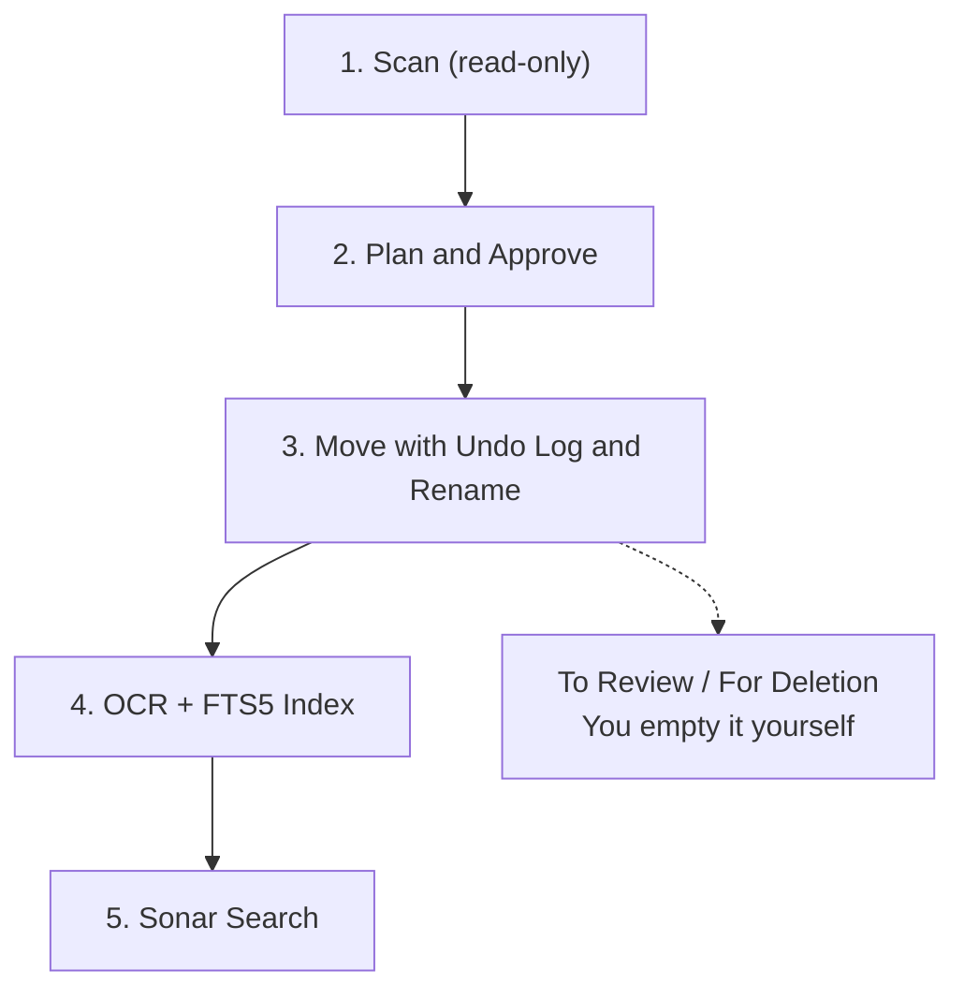

# Personal File Organization Kit

A complete, shareable recipe for turning a messy Windows PC (Desktop, Downloads, Documents, old backups, external drives) into a tidy, searchable family filing cabinet, built and maintained by an AI coding agent. Works with any agent that can run shell commands on your PC: Codex, Claude Code, Grok, Cursor, or similar.

> All names, companies, and paths in this kit are placeholders. Replace `<You>`, `<Spouse>`, `<Kid1>`, `<Kid2>`, `<Parents>`, `<Employer>`, `<Bank>`, `<Brokerage>` with your own.

## How it works

The kit is a five-stage pipeline. Every stage runs locally on your PC. Nothing is ever permanently deleted, and a file is never overwritten.



1. **Scan (read-only).** The agent inventories Desktop, Downloads, Documents, and any backups or external drives you point it at. It reads names, types, hashes, and page 1 of documents. It does not move anything yet.
2. **Plan and approve.** Every proposed move or rename is written to a plan (a manifest CSV) and shown to you with counts, samples, and a recommendation. You approve before anything is applied. Unattended bulk runs (old backups or an external drive) still write a plan and an undo log.
3. **Move with an undo log, and rename.** Approved plans are applied in PowerShell, without `-Force`. On a collision the file is skipped and reported. Exact SHA-256 duplicates and junk go to `To Review\For Deletion` — you empty that folder yourself. Every applied move is recorded in an undo log so it can be reversed.
4. **OCR and FTS5 index.** Scanned PDFs get a searchable text layer (the untouched original is kept in `To Review\OCR Originals`). Then a local SQLite FTS5 index is built from file names, paths, and the text inside PDFs, Word, Excel, PowerPoint, and text files. Nothing is uploaded.
5. **Sonar search.** Search the cabinet from a small desktop app (`scripts\sonar_app.pyw`) or the terminal (`python scripts\sonar.py "<words>"`). Sonar can also sort a folder with preview, apply, and undo, and flag IDs that are about to expire.

**Getting started.** [GETTING_STARTED.md](GETTING_STARTED.md) is the short walkthrough for both paths:

- **You cloned this repo.** Follow that file (or the quick start below) and open the folder in Cursor, Claude Code, Codex, or a similar agent so `AGENTS.md` / `CLAUDE.md` are picked up automatically. The scripts in `scripts\` are already here.
- **You don't want to clone anything.** Download just [GETTING_STARTED.md](GETTING_STARTED.md), upload or paste it into ChatGPT, Claude, Gemini, Cursor, or any other LLM, and follow the starter prompt inside it.

## Quick start with this repo

This repo already contains the finished scripts (`scripts\`) and agent rules (`AGENTS.md`, `CLAUDE.md`, `.cursor\rules\agents.mdc`), so you can skip most of Prompt A. For a fuller walkthrough, including a copy-paste prompt you can use without cloning, see [GETTING_STARTED.md](GETTING_STARTED.md).

1. Install the prerequisites in [section 6](#6-prerequisites-and-install-windows), then run `python -m pip install -r requirements.txt`.
2. Clone or copy the repo to a project folder, e.g. `%USERPROFILE%\Documents\Projects\file-organizer-kit`.
3. Copy `config.example.json` to `config.json` and edit it: your cabinet root, your people tokens (`You`, `Spouse`, `Kid1` …) and their nicknames, and the `75 <You>` folder name. `config.json` is git-ignored, so your details never get committed.
4. Open the folder in your agent (Cursor, Codex, Claude Code, Grok …). It reads `AGENTS.md` automatically. Ask it to "run Prompt A, but the scripts already exist: create the cabinet folders, the plans files and the shortcuts, then run the tests in Part 4."
5. Build the index once with `python scripts\sonar_index.py index`, then search with `python scripts\sonar.py "<words>"` or open `scripts\sonar_app.pyw`.

Everything the scripts write (index, plans, undo logs) is git-ignored. Never commit `config.json`, `_index\` or `plans\`.

## Contents

- [How it works](#how-it-works)
- [Quick start with this repo](#quick-start-with-this-repo)
- [GETTING_STARTED.md](GETTING_STARTED.md) — walkthrough and paste-into-any-LLM prompt

1. [What this is](#1-what-this-is)
2. [Principles](#2-principles)
3. [Folder structure template](#3-folder-structure-template)
4. [Recommended naming convention](#4-recommended-naming-convention)
5. [Lessons learned](#5-lessons-learned)
6. [Prerequisites and install (Windows)](#6-prerequisites-and-install-windows)
7. [Project layout](#7-project-layout)
8. [Prompt A: master build prompt](#8-prompt-a-master-build-prompt)
9. [Prompt B: per-folder session prompt](#9-prompt-b-per-folder-session-prompt)
10. [Prompt C: unattended bulk prompt](#10-prompt-c-unattended-bulk-prompt-old-backup-or-external-drive)
11. [Daily use](#11-daily-use)
12. [Troubleshooting](#12-troubleshooting)

---

## 1. What this is

This kit describes a local-only system, with no cloud uploads, for organizing every personal document a household owns. An AI agent sorts files into a numbered "cabinet" of folders, renames them to a predictable standard, OCRs scanned PDFs so their text can be searched, and builds a full-text index you can search from a small desktop app or the terminal. Nothing is ever permanently deleted. Anything that looks like junk or a duplicate goes to a review folder, and you empty it yourself. The agent works in logged, reversible sessions. It handles the rule-following work and leaves only real judgment calls for you, grouped and with a recommendation for each.

**What you get**

| Piece | What it does |
|---|---|
| Folder cabinet | `00 Inbox` … `80 Photos`, one numbered "drawer" per life area, with per-person subfolders |
| Naming standard | `Person_Type_Date_Detail`, ID expiry dates in the name, Money files sorted by date |
| Safe dedupe | SHA-256 exact matches only, moved to `To Review\For Deletion`, never deleted |
| OCR | Scanned PDFs get a text layer (OCRmyPDF), with untouched originals kept in `To Review\OCR Originals` |
| Local index | SQLite FTS5 index of names, paths and document text (PDF, Word, Excel, PowerPoint, text) |
| Search app | Desktop window with Search, Sort a folder and Expiring tabs, filters and a preview pane |
| `sonar` / `ssort` | Terminal search with clickable results, and a "sort this folder" tool with preview/apply/undo |
| Audit | Checks every name against the standard and flags copies, vague names, `Exp-5555` and duplicates |
| Agent protocol | Locks, session logs, STATUS board and ISSUES list. Runs unattended and logs issues for your review |

---

## 2. Principles

1. **Never delete.** "Delete" always means *move to* `To Review\For Deletion\...`. You empty it yourself after a look.
2. **Dry run, then apply.** Every move or rename is first written as a plan (CSV) and shown. It's applied only after you approve, or, for unattended runs, it's applied with an undo log.
3. **Undo logs for everything.** Every applied move or rename writes `source,dest,timestamp` to an undo CSV, and an undo script reverses it.
4. **Never overwrite.** Check that the target is free before each move. On a collision, skip and log. Never `Move-Item -Force`.
5. **Skip shortcuts and system files:** `.lnk`, `desktop.ini`, `thumbs.db`, `~$` temp files, `System Volume Information`, `$RECYCLE.BIN`, `FOUND.000`.
6. **Hash before calling anything a duplicate.** Only exact SHA-256 matches count. The same name or a similar size proves nothing.
7. **Never rename code or projects.** Move code, project folders and app bundles whole.
8. **Make small reversible calls yourself, and ask only about judgment calls.** Group those calls by folder or type (not one per file), each with a recommendation and an `Invoke-Item "<path>"` command so the human can open the file in one step.
9. **Recommend, don't just ask.** Every flag comes with a proposed name or destination and the reason for it.
10. **Done means verified.** A session is only done when the audit is clean (or only needs-human items remain), the session log is written, STATUS is updated and the lock is released.

---

## 3. Folder structure template

The cabinet root is `%USERPROFILE%\Documents\Family`. The review area sits *outside* the cabinet at `%USERPROFILE%\Documents\To Review`. The top-level folders are fixed. The subfolders shown are generic examples: the agent scans your files, starts from these examples, adds or drops subfolders to fit what you actually own, and creates them only after you approve.

```
%USERPROFILE%\Documents\Family
├── 00 Inbox
├── 10 Identity
│   ├── IDs
│   ├── Passports
│   ├── Insurance Cards
│   └── _Emergency
├── 15 Travel
│   ├── Trips
│   └── Trip Ideas
├── 20 Health
│   ├── <You>
│   ├── <Spouse>
│   ├── <Kid1>
│   └── <Kid2>
├── 30 Home
│   ├── Property
│   ├── Mortgage
│   ├── Bills and Utilities
│   ├── Vehicles
│   ├── Insurance and Warranties
│   ├── Manuals
│   └── Projects
├── 40 Money
│   ├── Taxes
│   │   └── <YYYY>_Tax
│   ├── Banking
│   ├── Investments
│   ├── Retirement
│   ├── Receipts
│   └── Budget
├── 50 Legal
│   ├── Estate Planning
│   ├── Contracts
│   └── Leases
├── 60 Work
│   ├── Career
│   ├── Employers
│   └── Job Search
├── 65 Learning
│   └── <Course or Subject>
├── 70 Kids
│   ├── <Kid1>
│   │   └── <Kid1>_School
│   └── <Kid2>
│       └── <Kid2>_School
├── 75 <You>
│   └── Miscellaneous Personal Docs
├── 80 Photos
│   └── <YYYY>_Photos
├── _index          ← index.db lives here (tooling, never organized)
└── README.md       ← your folder list + naming convention (source of truth)

%USERPROFILE%\Documents\To Review
├── For Deletion
└── OCR Originals
```

The subfolders above are common starting examples, not a fixed list. The agent keeps the ones you need, drops the empty ones, and suggests others based on what it finds in your files.

**What goes where, and how to subdivide it**

| Folder | What typically goes here | How to subdivide |
|---|---|---|
| `00 Inbox` | Anything not filed yet: new downloads, scans, files the agent wasn't sure about | No subfolders, except a temporary one per bulk import (e.g. `00 Inbox\<old-backup-name>`). Names stay as they arrived until filed |
| `10 Identity` | IDs, passports, birth certificates, insurance cards, an emergency info sheet | By document type: `IDs`, `Passports`, `Insurance`, `_Emergency`. Put the person in the filename, not in a folder |
| `15 Travel` | Itineraries, bookings, travel insurance, trip ideas | `Trips` (a subfolder per big trip if it has many files) and `Trip ideas` |
| `20 Health` | Doctor, dental, vision, pharmacy and lab records, explanation-of-benefits statements | One subfolder per person: `<You>`, `<Spouse>`, `<Kid1>`, `<Kid2>`, `<Parents>` |
| `30 Home` | Property papers, mortgage statements and payoff letters, bills and utilities, vehicles, warranties, manuals, home projects | By topic: `Property`, `Mortgage` (one folder for the loan, statements named by date; a refinance gets its own `Mortgage\<Lender>_<YYYY>`), `Bills and Utilities`, `Vehicles`, `Insurance and Warranties`, `Manuals`, `Projects\<ProjectName_Year>` |
| `40 Money` | Tax returns and forms, bank and brokerage statements, retirement accounts, receipts, budgets | Taxes by year (`Taxes\<YYYY>_Tax`), `Banking\<Bank>`, `Investments\<Brokerage>`, `Retirement`, `Receipts`, `Budget` |
| `50 Legal` | Wills and other estate planning documents, contracts, leases, agreements | By topic: `Estate Planning`, `Contracts`, `Leases`. Keep it shallow |
| `60 Work` | Resumes, certifications, offer letters, reviews, pay stubs, work projects | `Career`, `Employers\<Employer>`, `Job search` (optional, excluded from renaming), `Projects` |
| `65 Learning` | Courses, books, study notes, certificates in progress | One subfolder per course or subject. Skipped by OCR |
| `70 Kids` | School records, report cards, activity forms | One subfolder per child with a single `<KidN>_School` folder inside. No tiny folders like "Homework" |
| `75 <You>` | Your own papers that don't fit another drawer: school diplomas and transcripts, certificates, memberships, hobby and personal project files, letters and keepsakes | Start with one `Miscellaneous Personal Docs` folder. Split out a topic folder only once it has enough files to justify it |
| `80 Photos` | Photos and scans of photos | By year with a topic word (`2025_Photos`, never just `2025`). Skipped by OCR |
| `To Review\For Deletion` | Exact duplicates, installers, temp files, junk. **Nothing is ever deleted by the agent** | One subfolder per reason: `<folder> duplicates`, `Downloads junk`, `already-on-PC`. Relative paths are preserved |
| `To Review\OCR Originals` | Untouched copies of PDFs from before OCR | Mirrors the cabinet paths. Clear it once you're happy with the OCR results |

**Structure rules**
- **Documents that never change get one folder; documents that repeat get a folder per year.** IDs, passports, birth certificates, a property deed or a will are one-time or rarely updated, so each type lives in a single folder and the newest version is easy to find (`10 Identity\Passports`). Taxes, statements and receipts come every year, so they're grouped by year (`40 Money\Taxes\2025_Tax`), which keeps each year's packet together and lets you archive old years in one move. When in doubt, ask: will I get a new one of these next year? If yes, organize by year; if no, keep it in one folder.
- Number the drawers (`00`, `10`, `15` …) so they always sort in the same order. The gaps leave room to add drawers later (e.g. `76 <Parents>` if you manage a parent's papers, or `90 Archive` for old files you want to keep).
- A folder is a packet you grab, not a person, so the person goes in the filename. Per-person subfolders exist only where a drawer is mostly per-person (Health, Kids).
- Add deeper subfolders only where they do real work (tax years, per-institution statements, per-project). Don't create a folder for three files.
- A subfolder name always needs a topic word. Never use a bare year.
- Never file email, passwords or live login details in the cabinet.

---

## 4. Recommended naming convention

One consistent pattern per category lets you find a file by its name alone, makes it sort correctly in Explorer, and lets the audit check every name automatically.

**Formatting rules (apply to every category)**
- Dates are always `YYYY-MM-DD`. Use `YYYY-MM` or `YYYY` only when that's all the document gives you.
- Use underscores `_` **between** parts and hyphens `-` **within** a part: `KitchenRemodel_Quote_2026-03-04_Contractor-A.pdf`.
- No spaces, and lowercase extensions (`.pdf`, `.jpg`).
- Person and project tokens are CamelCase with no separators (`Kid1`, `KitchenRemodel`).
- Never use `Copy`, `- Copy`, `Old`, `_old`, `(1)`, `.bak`, `final`, `v2` or `Draft2`. If two genuinely different files would get the same name, add a meaningful word instead: `Filed-Scan`, `PriorFormat`, `OriginalResolution`, `Signed`.
- Use straight apostrophes only (`'`, not `’` or `‘`). Better still, leave apostrophes out.
- The date comes from the filename or page 1 of the document. It's never the file's modified date, and never a scanner prefix like `04192026_` (that's when it was scanned).

**Why the parts are ordered this way**
- **Person first** in personal drawers (`<Kid1>_Dental_…`). Explorer groups each person's files together, and typing the name in search narrows results right away.
- **Date first** in Money (`2026-02-21_<Bank>_Statement…`). Money is usually looked up by when it happened, and `YYYY-MM-DD` at the front sorts in time order automatically.
- **Tax year first** in tax files (`2025_Tax_…`). A whole tax year sorts together, ready to hand to a preparer.
- **Expiry last** on IDs (`…_Exp-2030-01-31`). The `Expiring` tab and `sonar --expiring` read it, and it's always in the same place.
- **Type before detail.** The broad category (Dental, Statement, Quote) comes before the specifics (provider, item), so similar documents sort together.
- The indexer also splits names into words (`KitchenRemodel_Quote` becomes "kitchen remodel quote"), so every part of a name is searchable.

**Pattern and examples per category**

| Category | Pattern | Examples |
|---|---|---|
| Person documents (Health, Kids, Travel, Legal, `75 <You>`) | `Person_Type_Date_Detail.ext` (no date: `Person_Type_Detail.ext`) | `Kid1_Dental_2026-10-01_Checkup.pdf`<br>`Spouse_Lab_2025-11-03_BloodWork.pdf`<br>`Kid2_School_2026-09-01_ReportCard.pdf` |
| IDs and passports | `Person_DocType_[Date]_Exp-YYYY-MM-DD.ext` (expiry always last) | `You_DL_Exp-2030-01-31.pdf`<br>`Kid2_Passport_Issued-2026-03-19_Exp-2031-03-18.pdf`<br>`Spouse_DL_Exp-5555.jpg` (only if the expiry is truly unreadable) |
| Docs that never expire | `Person_DocType.ext` (no `Exp` token) | `Kid1_BirthCertificate.pdf`<br>`You_SocialSecurityCard.pdf` |
| Insurance cards | `Person_Carrier_Side.ext` | `You_<Insurer>_Front.png`<br>`Kid1_<Insurer>_Back.png` |
| Portrait photos | `Person_PhotoType_NN.ext` | `Kid2_PassportPhoto_01.jpg`<br>`You_Headshot_02.jpg` |
| Dated photos (80 Photos) | `Person_Photo_YYYY-MM-DD_Detail.ext` | `Kid1_Photo_2026-04-09_Birthday.jpg`<br>`Family_Photo_2025-07-04_Beach.jpg` |
| Home (no person) | `Project_Type_Date_Detail.ext` | `Home_Deed_2020-03-15.pdf`<br>`KitchenRemodel_Quote_2026-03-04_Contractor-A.pdf`<br>`Car_Registration_2026-05-01.pdf` |
| Money | `YYYY-MM-DD_Source_DocType_Detail.ext` (no person) | `2026-02-21_<Bank>_Statement.pdf`<br>`2026-03-10_<Brokerage>_TradeConfirm.pdf`<br>`2026-01-15_Utility_Bill_Electric.pdf` |
| Tax | `YYYY_Tax_Form_Source.ext` | `2025_Tax_1098_<Bank>.pdf`<br>`2025_Tax_W2_<Employer>.pdf`<br>`2025_Tax_Return_Federal.pdf` |
| Work | `Person_Type_Date_Detail.ext` or `<Employer>_Type_Date.ext` | `You_Resume_2025-11-10.pdf`<br>`<Employer>_OfferLetter_2025-01-15.pdf` |
| Tools, templates, research | `Topic_Type_Detail.ext` | `Budget_Template_Annual.xlsx`<br>`Mortgage_Calculator_Refinance.xlsx` |
| `00 Inbox` | Leave the name as it arrived | — |

**Never rename**
- Code and app files (`.py .js .ts .tsx .html .css .json .ps1 …`), dashboards and project folders. Move them whole.
- `60 Work\Job search` (optional; many people prefer to thin it themselves).
- Your own camera-roll photos, if you'd rather thin them yourself (optional).
- Saved-web-page `*_files` asset folders (the page breaks).
- Generated output (transcripts, audio, slide images, logs) and export bundles left as they arrived.

These go in `plans\check-exceptions.txt` (see §7) so the audit doesn't flag them.

---

## 5. Lessons learned

These are corrections from a real multi-week cleanup. Put all of them in the agent's rules.

**Naming and dates**
- Use `Exp-5555` only when an ID that has an expiry is truly unreadable. Never invent an expiry date. Docs that don't expire get no `Exp` token.
- A scanner date prefix is not a document date. The file's modified time is not a document date either.
- If there's no readable document date, keep the original name and log a grouped needs-human issue. Don't guess.
- Read page 1 before assigning a person. Memory is wrong more often than you'd think. A vital record "everyone knew" was one kid's turned out to belong to the other.

**Copy-token traps**
- `Copy`, `_old`, `(1)` and `- Copy` mark duplicates for the audit. Don't leave them in keeper names.
- `X_Filed.pdf` and `X_Filed-Copy.pdf` turned out to be *different* files (different size and hash). Check that the target doesn't exist before every rename. If both files are real, keep both under distinct names.

**Duplicates and thinning**
- SHA-256 before calling anything a duplicate. Archive wrappers (`.7z` / `.zip`) and overlapping extracts can share names without being byte-identical.
- Same-day receipts with `-b` / `-c` suffixes are separate transactions. Don't thin receipts.
- Never auto-thin drafts, near-copies or "looks similar" sets. Only exact hash matches go to For Deletion, unless the human names a specific file.
- Keep one canonical copy of a course or library. If a tracker spreadsheet maps those files, update it in the same session as any rename (every row has a file, every file has a row).

**Filenames, backups and generated output**
- Normalize curly apostrophes (`’` `‘`) to straight `'` in filenames.
- Backups of edited scripts or docs go in `plans\` with a timestamp, **never** next to the original. `.bak` files beside originals create audit noise.
- Generated output (transcripts, audio, slide images, logs) gets a `prefix:` exception. Never mass-rename it.
- Add exceptions only for standing exclusions the human has approved, never to hide unfinished work.

**Locked files and encoding**
- A file that's open in a PDF viewer or Office can't be moved ("Access Denied"). Log it as skipped/locked and move on. Don't retry in a loop. A failed apply that leaves a header-only undo log must not be used for undo.
- Windows PowerShell 5.1 reads scripts as ANSI unless they're saved as **UTF-8 with BOM**. Any script containing non-ASCII characters (curly quotes, en dashes, accented names) needs the BOM. Markdown docs can stay plain UTF-8.

**Session hygiene**
- Never report done until the audit has run, the session log is written, STATUS is updated and the lock is released. Agents like to say "done" early. The protocol makes them prove it.
- At the start of a session, reconcile ISSUES and STATUS with the disk and undo logs. The human or another tool may have changed things in between.
- Group needs-human issues by folder or type, each with a recommendation and `Invoke-Item` commands.
- Don't move files into a folder another session has locked.
- If an undo-log timestamp would collide, add a suffix (`-2`). Never overwrite another session's log.
- When the folder tree changes, update `Family\README.md` (back it up to `plans\` first).

**Respect the human's choices**
- Files the human already deleted (in the Recycle Bin, or missing with no undo record) were deleted on purpose. Never restore them.
- Leave one-off files you can't identify as they are and add a `name:` exception rather than guessing a type or date.

**OCR**
- Skip `65 Learning` (books) and `80 Photos`. Skip `60 Work` too unless the human asks for it.
- Always keep the untouched original in `To Review\OCR Originals`, with its relative path preserved.
- Re-index after OCR. Don't claim that content search works until the index actually stores the extracted text.

**Agent behavior**
- Agents sometimes stop to ask "Want me to continue?". For unattended runs, forbid that explicitly (see §10).
- Agents can't see what another app on your desktop is doing. Have them work through files on disk (STATUS.md, ISSUES.csv, session logs) so any agent can pick up where another left off.

---

## 6. Prerequisites and install (Windows)

Open **PowerShell** (Windows Terminal or any terminal running a PowerShell tab) and run:

```powershell
# Python 3.11+ (3.12 recommended). Tick "Add python.exe to PATH" if using the python.org installer.
winget install -e --id Python.Python.3.12

# Tesseract OCR engine (UB Mannheim build)
winget install -e --id UB-Mannheim.TesseractOCR

# Ghostscript (OCRmyPDF needs it; also a fallback PDF renderer)
winget install -e --id ArtifexSoftware.GhostScript

# Optional: Git, to version the project scripts
winget install -e --id Git.Git
```

If `winget` isn't available, download the installers manually: python.org, the UB Mannheim Tesseract page (github.com/UB-Mannheim/tesseract/wiki) and ghostscript.com.

**Add Tesseract and Ghostscript to PATH** if the installers didn't. Typical folders:
- `C:\Program Files\Tesseract-OCR`
- `C:\Program Files\gs\gs<version>\bin`

Settings → System → About → Advanced system settings → Environment Variables → Path → New. Then **close and reopen** the terminal.

**Python packages**

```powershell
python -m pip install --upgrade pip
python -m pip install ocrmypdf pymupdf pypdf pillow python-docx openpyxl python-pptx
# optional: preview iPhone HEIC photos
python -m pip install pillow-heif
```

**Verify**

```powershell
python --version                 # 3.11 or newer
tesseract --version
gswin64c -version
ocrmypdf --version
python -c "import fitz, pypdf, docx, openpyxl, pptx, PIL; print('python libs OK')"
python -c "import sqlite3; c=sqlite3.connect(':memory:'); c.execute('create virtual table t using fts5(x)'); print('FTS5 OK')"
```

**Gotchas**
- **PowerShell 5.1 and UTF-8:** save `.ps1` files that contain any non-ASCII character as *UTF-8 with BOM*, or 5.1 garbles them. PowerShell 7 (`winget install Microsoft.PowerShell`) doesn't have this problem.
- **`Invoke-Item` needs a PowerShell tab.** If you use Warp, Windows Terminal or VS Code, make sure the tab is PowerShell, not cmd or WSL, or the review commands won't open files.
- **Execution policy:** if scripts won't run, use `Set-ExecutionPolicy -Scope CurrentUser RemoteSigned`.
- **Sleep:** for overnight runs, set Settings → System → Power → Sleep to **Never** while plugged in.
- **Agent approval prompts:** most agents ask before each shell command. For attended sessions that's your safety gate. For unattended runs use a tool or mode that can loop on its own, and rely on the undo logs.

---

## 7. Project layout

The project folder holds the scripts, rules and logs. It is **not** the cabinet itself.

```
%USERPROFILE%\Documents\Projects\file-organizer-kit
├── GETTING_STARTED.md         walkthrough + paste-into-any-LLM prompt
├── README.md                  full guide
├── config.example.json        settings template: copy to config.json (git-ignored) and edit
├── requirements.txt           Python packages
├── AGENTS.md / CLAUDE.md / .cursor\rules\*.mdc   ← agent rules (use whichever your tool reads)
│     file-naming        naming standard + process
│     file-moves         move safety rules
│     session-protocol   start / self-review / definition of done / finish
│     lessons-learned    §5 of this kit
├── scripts
│   ├── organize.ps1           simple folder-to-folder mover (dry-run default, -Apply)
│   ├── apply-manifest.ps1     apply a Source,Dest CSV (dry-run default, -Apply) + undo log
│   ├── undo-manifest.ps1      reverse an undo log (dry-run default, -Apply)
│   ├── check.ps1              audit one cabinet folder (calls sonar_index.py audit)
│   ├── sonar_index.py         indexer + search + audit (reads config.json)
│   ├── sonar_ocr.py           OCR plan/apply
│   ├── sonar.py               terminal search (sonar)
│   ├── sonar_app.pyw          desktop app
│   ├── sonar_preview.py       preview renderer for the app
│   ├── sonar_sort.py          sort engine (ssort)
│   └── sonar_sort_rules.json  editable sort rules
├── plans
│   ├── STATUS.md              one line per cabinet folder: state, latest undo log, open issues
│   ├── ISSUES.csv             issue tracker (columns below)
│   ├── check-exceptions.txt   audit exclusions
│   ├── locks\                 <folder-slug>.lock while a session works a folder
│   ├── sessions\              YYYYMMDD-HHMMSS-<folder-slug>.json session logs
│   ├── sort-plans\            ssort preview plans
│   ├── *-manifest.csv         rename/move plans (Source,Dest,Group,Reason,DateSource)
│   └── undo-log-*.csv         every applied move
└── NOTES.md                   standing preferences + decisions log (human-readable memory)
```

**`plans\ISSUES.csv` columns**

```
"id","folder","path","problem","proposed_fix","status","owner","opened","closed"
```
- `id`: `ISS-001`, `ISS-002` …
- `status`: `open` (the agent can fix it under the rules), `needs-human` (a judgment call), `closed`
- `owner`: `agent` or `human`
- `proposed_fix`: always a recommendation, plus `Invoke-Item "<full path>"` for needs-human rows

**`plans\STATUS.md` example**

```
# Cabinet status. Last updated 2026-01-10 09:15 (local)
| Folder | State | Latest undo log | Open issues |
|---|---|---|---|
| 10 Identity | done | plans\undo-log-20260110-091200.csv | 0 |
| 40 Money | needs-human | plans\undo-log-20260109-221500.csv | 3 |
| 30 Home | not started | — | — |
```

**`plans\check-exceptions.txt` format**

```
# Audit exclusions. One per line; blank lines and # comments ignored.
#   prefix:<path relative to cabinet root>   skip anything under this prefix
#   name:<substring>                          skip if file name contains this (case-insensitive)
#   glob:<wildcard>                           skip if relative path matches
#   kind:code                                 skip code/script extensions (default; documentation)
prefix:60 Work\Job search
prefix:65 Learning\<Course>\Study
name:unknown-receipt-700.pdf
kind:code
```

**Session log schema** (`plans\sessions\YYYYMMDD-HHMMSS-<slug>.json`)

```json
{
  "session_id": "string",
  "folder": "40 Money",
  "started": "2026-01-10T09:00:00-05:00",
  "ended": "2026-01-10T09:40:00-05:00",
  "counts": {"renamed": 0, "moved": 0, "skipped": 0, "held": 0, "errors": 0},
  "undo_log": "plans\\undo-log-....csv or null",
  "held_files": [{"path": "...", "reason": "..."}],
  "issues_opened": ["ISS-012"],
  "issues_closed": ["ISS-007"],
  "check_summary": "0 nonconforming, 0 copy-pattern, 1 needs-human",
  "notes": "string"
}
```

---

## 8. Prompt A: master build prompt

Paste this into your agent once, from an empty folder at `%USERPROFILE%\Documents\Projects\file-organizer-kit`. Fill in the **MY HOUSEHOLD** block first. The prompt builds the whole system: rules, scripts, app and shortcuts. It does **not** move any of your files yet.

````text
You are building a local, privacy-preserving personal file-organization system on my Windows PC.
Work in the current folder (the PROJECT). Use PowerShell and Python only. No cloud services, no uploads.
Build everything below, test it, and report. Do NOT move, rename, or OCR any of my real files in this build;
only create the project, the empty cabinet folders, and the tools.

MY HOUSEHOLD (edit before running):
- Cabinet root: %USERPROFILE%\Documents\Family
- Review root:  %USERPROFILE%\Documents\To Review
- People tokens (used in filenames): <You>, <Spouse>, <Kid1>, <Kid2>, <Parents>
  Aliases for detection (nicknames/spellings): <You>: [<you-alias>], <Spouse>: [...], ...
- Kids: <Kid1>, <Kid2>
- Employers / banks / brokerages I deal with: <Employer>, <Bank>, <Brokerage>
- Time zone for logs: <your IANA zone, e.g. America/New_York>

======================================================================
PART 1. RULES FILES (agent-neutral)
======================================================================
Write the rules in whichever place my agent tool reads automatically:
- Codex / generic: AGENTS.md at the project root
- Claude Code: CLAUDE.md (may simply say "Follow AGENTS.md" and include it)
- Cursor: .cursor\rules\*.mdc with `alwaysApply: true` front matter
If unsure, create AGENTS.md AND a CLAUDE.md that points to it.
Create four sections/files: file-naming, file-moves, session-protocol, lessons-learned.

file-naming: ENFORCE the "Recommended naming convention" from this kit (Section 4) on every rename.
Copy its pattern table, formatting rules, and never-rename list into this rules file verbatim:
- Person docs: Person_Type_Date_Detail.ext ; no date: Person_Type_Detail.ext
- IDs/passports: Person_DocType_[Date]_Exp-YYYY-MM-DD.ext, expiry last; Exp-5555 ONLY if an expiring ID is
  truly unreadable; documents that never expire get no Exp token.
- Insurance cards: Person_Carrier_Side.ext
- Photos: Person_PhotoType_NN.ext ; dated photos in 80 Photos: Person_Photo_YYYY-MM-DD_Detail.ext
- Home (no person): Project_Type_Date_Detail.ext
- 40 Money: YYYY-MM-DD_Source_DocType_Detail.ext (no person); tax: YYYY_Tax_Form_Source.ext
- Work: Person_Type_Date_Detail.ext or <Employer>_Type_Date.ext ; tools/templates: Topic_Type_Detail.ext
- Formatting: dates YYYY-MM-DD (or YYYY-MM / YYYY); underscores between parts, hyphens inside a part;
  no spaces; CamelCase person/project tokens; lowercase extensions; straight apostrophes only.
- Banned tokens in final names: Copy, - Copy, Old, _old, (1), .bak, final, v2, DraftN. Distinguish real
  different files with a meaningful word (Filed-Scan, PriorFormat, OriginalResolution, Signed).
- Date source: filename, then page 1 of the PDF. Never file modified time. MMDDYYYY scanner prefixes are
  scan dates, not document dates.
- Never rename code/dashboards/project folders/saved-page *_files folders/generated output; Job search
  excluded (optional); 00 Inbox keeps names until filed.
- Exact duplicates (SHA-256 only) go to To Review\For Deletion\<folder> duplicates\. Never delete.
- Unsure about person/date/type: hold the file out, list it with an Invoke-Item command.
- The audit (sonar_index.py audit / check.ps1) must check these exact patterns; a rename that fails the
  audit is not done.
- Process: build plans\<folder>-rename-manifest.csv (Source,Dest,Group,Reason,DateSource) -> dry run ->
  show counts/samples/held files/recommendations -> apply on approval -> re-list -> report undo log path.

file-moves:
- Dry-run by default; apply only after approval. Never move .lnk or desktop.ini.
- Never Move-Item -Force. Collision = skip and report. No silent deletes. Always write an undo log.
- Pass explicit paths; don't add Desktop/Documents as workspace roots.

session-protocol:
START: read plans\STATUS.md and open rows of plans\ISSUES.csv; reconcile both with the filesystem and
undo logs; claim plans\locks\<folder-slug>.lock (session_id, start time, scope); skip locked folders;
report locks older than 24h, never take them over silently. Dry-run before applying.
SMALL CALLS: do listings, hashes, manifests, check runs, logs, STATUS/ISSUES updates without asking.
Ask only before applying a manifest or anything irreversible.
RECOMMEND: every flag gets a proposed name/destination and a reason.
SELF-REVIEW after every apply: run scripts\check.ps1 -Folder <path>; turn every remaining flag into an
ISSUES row; auto-fix rule-conforming ones in a follow-up dry-run; mark only true judgment calls
needs-human, each with recommendation + Invoke-Item "<full path>" (one per path). Loop.
DEFINITION OF DONE: check reports 0 nonconforming and 0 copy-pattern names (excluding documented
exceptions), 0 open agent-owned issues for the folder, and a session log exists. If only needs-human rows
remain, stop and say so. Never report done until the lock is released, the session log is written and
STATUS.md is updated.
FINISH (in order): check.ps1 -> session log plans\sessions\YYYYMMDD-HHMMSS-<slug>.json (schema: session_id,
folder, started, ended, counts{renamed,moved,skipped,held,errors}, undo_log, held_files[{path,reason}],
issues_opened, issues_closed, check_summary, notes) -> update ISSUES statuses/closed dates -> update the
folder's STATUS line and header timestamp -> add a Decision line to NOTES.md only for new decisions ->
delete the lock.
SAFETY: never delete; For Deletion only for exact SHA-256 matches unless I name a file; exceptions only
for standing exclusions I approved.

lessons-learned (copy these verbatim as rules):
- Never invent expiry dates; Exp-5555 only for unreadable expiring IDs.
- Scan-date prefixes and file mtimes are never document dates; no readable date = keep name + grouped issue.
- Read page 1 before assigning a person; don't rely on memory.
- Copy, _old, (1), "- Copy", .bak, DraftN are duplicate markers; never leave them in keeper names. Use
  Filed-Scan / PriorFormat / OriginalResolution to distinguish real different files.
- Check the target doesn't exist before every rename/move; same-looking names can be different files.
- SHA-256 before calling anything a duplicate; never auto-thin drafts or near-copies; -b/-c same-day
  receipts are separate transactions.
- Keep one canonical copy of a course/library; update any tracker in the same session as renames.
- Normalize curly apostrophes to straight ones in filenames.
- Backups of edited files go to plans\ with a timestamp, never beside the original.
- Generated outputs (transcripts, audio, slides, logs) and saved-page *_files folders: exception, no renames.
- Locked file (Access Denied): log as skipped/locked, continue, no endless retries. A header-only undo log
  from a failed apply must not be used for undo.
- PowerShell 5.1 scripts with non-ASCII characters must be saved as UTF-8 with BOM.
- Reconcile ISSUES/STATUS with disk at session start; group needs-human issues by folder/type.
- Never move into a folder another session has locked; undo-log name collision -> add -2 suffix.
- Update Family\README.md when the tree changes (back it up to plans\ first). Subfolders need a topic word,
  never a bare year.
- Files I already deleted are intentional; never restore them.
- OCR: skip 65 Learning, 80 Photos, 60 Work; originals to To Review\OCR Originals; re-index after OCR.

======================================================================
PART 2. CABINET + README
======================================================================
Create ONLY the top-level cabinet folders now (skip any that exist):
00 Inbox, 10 Identity, 15 Travel, 20 Health, 30 Home, 40 Money, 50 Legal, 60 Work, 65 Learning, 70 Kids,
75 <You>, 80 Photos, _index. Also To Review\For Deletion and To Review\OCR Originals (outside the cabinet).

SUBFOLDERS: start from the example subfolders in Section 3, tailor them to my files, then wait for my approval.
1. Scan (read-only) my existing files in Desktop, Downloads, Documents, and any folder I name: list names,
   extensions, sizes, and folder context only. Do not read or summarize document contents beyond what is
   needed to recognise a document type.
2. Start from the example subfolders in the Section 3 tree and the per-folder guides. Keep the examples
   my files need, drop the ones that would be empty, and add others the scan calls for, e.g. tax-year
   folders (Taxes\<YYYY>_Tax) and institution folders (Banking\<Bank>) under 40 Money, one folder per person
   under 20 Health, one <KidN>_School folder per child under 70 Kids. Keep it shallow; a subfolder needs
   enough files to justify it and always has a topic word (never a bare year).
3. Show the proposal as a tree with a one-line reason and approximate file count per subfolder.
   Write it to plans\proposed-subfolders.md. Ask me to approve or edit it. Create subfolders only after I
   say yes (this is the ONLY question you may ask during the build; continue with Parts 3-4 meanwhile).

Write Family\README.md: the approved tree, the full Recommended naming convention (Section 4: pattern
table, formatting rules, never-rename list), and one example filename per folder. README is the source of
truth that the naming rules point to; update it (backup to plans\ first) whenever the tree changes.
Create plans\STATUS.md (one row per drawer, state "not started"), plans\ISSUES.csv (header:
"id","folder","path","problem","proposed_fix","status","owner","opened","closed"), plans\locks\,
plans\sessions\, plans\check-exceptions.txt (format: prefix:/name:/glob:/kind:code lines, # comments;
seed with prefix:60 Work\Job search and kind:code), NOTES.md (standing preferences + decisions log).

======================================================================
PART 3. SCRIPTS (write as specs say; test each)
======================================================================
THE SEARCH TOOL (the main thing I use daily; build all of it):
 - `sonar` terminal command: full-text search of file names, paths, and document contents (incl. OCR'd scans),
   ranked results with a matching-text snippet; each filename is a clickable OSC 8 link (Ctrl+click opens
   it); filters --folder, --person, --type, --from/--to; `sonar --expiring` lists IDs by expiry date;
   `sonar --reindex` refreshes the index.
 - "Sonar" desktop app (desktop shortcut): Search tab with the same filters as dropdowns and a
   preview pane (PDF page with Prev/Next, image, first lines of text/CSV, Word/Excel text); Sort a folder
   tab (preview, apply checked, undo last); Expiring tab (IDs due soon, soonest first).
 - `ssort` terminal command: sort a messy folder into the cabinet with preview -> apply -> undo.
 - All read-only on documents except ssort/Sort-tab moves, which never overwrite, never delete, and log undo.
 Specs follow in 3.4 (index/search engine), 3.7 (sonar), 3.8 (preview), 3.9 (ssort), 3.10 (app), 3.11 (shortcuts).

3.1 scripts\organize.ps1 -Source <dir> -Dest <dir> [-Apply]
 - Top-level files only; skip .lnk, .ini, desktop.ini. Dry run prints WOULD lines; -Apply moves.
 - Target exists -> print SKIP and continue. Never -Force. With -Apply, write an undo log
   plans\undo-log-<yyyyMMdd-HHmmss>.csv (Source,Dest,Time).

3.2 scripts\apply-manifest.ps1 -Manifest <csv> [-Apply]  and  scripts\undo-manifest.ps1 -Log <csv> [-Apply]
 - Manifest columns Source,Dest[,Group,Reason,DateSource]. Creates parent dirs. Dry run by default.
 - Skip if source missing, dest exists, or source is locked; count moved/skipped/errors; print summary.
 - Undo log written only for successful moves; never a header-only log on a fully failed run (or mark it).
 - Undo moves dest->source only when dest still exists and source path is free.
 - Use -LiteralPath everywhere (brackets in names). Save as UTF-8 with BOM.

3.3 config.json at the project root (template: config.example.json; config.json is git-ignored)
 { "cabinet_root": "%USERPROFILE%\\Documents\\Family", "review_root": "%USERPROFILE%\\Documents\\To Review",
   "index_db": "<cabinet>/_index/index.db", "exceptions": "plans/check-exceptions.txt",
   "people": { "You": ["you", ...], "Kid1": [...] }, "children": ["Kid1", "Kid2"],
   "folders": ["00 Inbox", ..., "80 Photos"], "extra_roots": [] }
 Every script reads it (config.json, else config.example.json; --config or SONAR_CONFIG override).
 The cabinet becomes the index root named "cabinet". Add extra_roots later (e.g. an external drive).

3.4 scripts\sonar_index.py (stdlib + pymupdf/pypdf, python-docx, openpyxl, python-pptx loaded lazily)
 Read-only on source files; the only write is the SQLite db. Subcommands:
 index [--root NAME|PATH] [--folder REL ...] [--hash-only] [--size-prefilter] [--db PATH]
 search QUERY [--limit N] [--folder] [--person] [--type] [--from] [--to]
 audit [--root] [--folder] [--days 180] [--json] [--report PATH]
 Schema: files(id, root, rel_path, name, ext, size, mtime_ns, sha256, split_name, body, content_status,
 content_error, content_chars, indexed_at, UNIQUE(root,rel_path)); index on sha256; meta(key,value);
 roots(name,path). FTS5 external-content table files_fts(name, rel_path, split_name, body,
 tokenize='unicode61 remove_diacritics 2') kept in sync with AFTER INSERT/UPDATE/DELETE triggers.
 Store a schema version in meta and rebuild FTS when it changes.
 Walk: skip dirs _index, .git, System Volume Information, $RECYCLE.BIN, FOUND.000; skip reparse points;
 skip desktop.ini, thumbs.db, *.lnk, ~$*. Paths stored relative with forward slashes.
 Incremental: if size and mtime_ns unchanged and hash+content present -> skip. Otherwise SHA-256 in 1 MB
 chunks. --size-prefilter: first stage all files, hash only files whose size is shared with another file
 (unique sizes can't be duplicates; mark content_status 'unique-size'). Commit every 500 files and print
 progress. Remove rows for files no longer on disk (stale) within the scanned prefix.
 Content extraction (cap 200 KB text/file, skip files > 200 MB, PDFs first 50 pages): PDF via PyMuPDF
 (fallback pypdf), docx paragraphs+tables, xlsx cell values (read_only, data_only), pptx slide text,
 text-like (.txt .csv .md .json .srt .vtt .log .html .xml .yml) decoded utf-8/utf-16/cp1252.
 Skip binary types (images, video, audio, archives). Record status ok/empty/skip/error + error text.
 split_name: stem with _ - . -> spaces, split CamelCase, acronym boundaries, letter/number boundaries,
 plus the extension (e.g. "KitchenRemodel_Quote2026" -> "Kitchen Remodel Quote 2026 pdf").
 Query syntax -> FTS5: words = AND; "exact phrase"; OR; -word or NOT = exclude; prefix*.
 Ranking: bm25(files_fts, 12.0, 4.0, 8.0, 1.0) (name, path, split_name, body). Snippet: first non-empty of
 body, split_name, name, with [ ] highlight and ~12 tokens. Filters: folder = top-level folder prefix;
 person = filename leads with that person token; type = PDF/Image/Word/Excel/Text/Video/Other by ext;
 date range matches filename dates OR mtime. If FTS returns nothing, fall back to LIKE on name/path.
 Expiring: list files whose name has Exp-YYYY-MM-DD (ignore 5555), with days left, sorted by date.
 Audit: load naming patterns from the file-naming rules + README (fail loudly if the rules file no longer
 contains the templates). Classify each folder: Inbox and Job search = exempt; 40 Money\Taxes = tax;
 40 Money = money; 10 Identity\IDs|Passports = id; 10 Identity\Insurance = insurance; 80 Photos = photo;
 Health/Travel/Legal/Kids/<You> = person; 30 Home = home; 60 Work = work; else topic. Report blocks:
 nonconforming names, copy-pattern names (regex: (N), copy, _old, .bak, DraftN), vague names (scan,
 document, untitled, img, IMG_1234, new, temp, download, misc, final...), version clutter (v2, final,
 _b/_c), Exp-5555, expiries within --days (and invalid dates), miscategorized (Money-looking file outside
 Money; person-led name inside Money; person mismatch vs parent folder), exact duplicates (same sha256,
 only relied on if size+mtime still match the live file) and possible duplicates (same normalized stem).
 Honor check-exceptions.txt; skip code extensions. Audit naming uses the live folder listing. Write the
 full report to plans\index-audit.txt (or --report) and print a short summary with counts.

3.5 scripts\check.ps1 -Folder <rel-or-abs> [-Root <cabinet>] [-Report] [-Json]
 Resolve folder inside the cabinet root (refuse paths outside), then run
 python sonar_index.py audit --root cabinet --folder <rel>. Exit with its exit code.

3.6 scripts\sonar_ocr.py
 plan  --folder <name> | --root <cabinet> [--exclude NAME ...] [--originals DIR]
 apply (same args) --yes   (refuse without --yes)
 Classify each PDF with pypdf: a page "has text" if >= 25 alphanumeric chars. Classes: has-text (skip),
 needs-ocr (all pages scanned), ocr-partial (mixed), encrypted/error (log, skip). plan writes a CSV log in
 plans\ (path, pages, class, note) and touches nothing. apply: for each candidate, copy the original to
 To Review\OCR Originals\<same relative path> (never overwrite), run
 ocrmypdf --skip-text --rotate-pages --deskew --language eng --optimize 0 --output-type pdf <src> <tmp>,
 then replace the source with tmp only on exit 0; on failure keep the original and log the exit code.
 Default excludes: 65 Learning, 80 Photos, 60 Work. Afterwards print: re-run the indexer.

3.7 scripts\sonar.py (the `sonar` command; also importable by the GUI)
 sonar QUERY [-n 20] [--folder] [--person] [--type] [--from] [--to] | sonar --expiring [--days 180] | sonar --reindex
 Read-only db connection. Each hit: number, filename as an OSC 8 clickable hyperlink
 (ESC]8;;file:///...ESC\ label ESC]8;;ESC\) so Ctrl+click opens it in Windows Terminal/Warp, folder,
 date, and snippet line. Enable VT processing and UTF-8 output on Windows. --reindex shells out to
 sonar_index.py index. Expose search(), expiring(), run_reindex() for the GUI.

3.8 scripts\sonar_preview.py
 preview(path, page) -> result(kind=image|text|meta|error, image path or text, details, page count).
 PDF: render page with PyMuPDF at ~100 DPI (fallback Ghostscript) into %TEMP%\sonar-previews;
 images via Pillow with EXIF orientation, max edge 1600 (HEIC via pillow-heif if installed);
 text/CSV: first 60 lines; docx: first paragraphs; xlsx: first rows of first sheet; else name/size/date.
 Never touch originals; LRU cache 32 entries; clean temp on exit; > 200 MB = metadata only.
 Heavy imports lazy so the app opens fast.

3.9 scripts\sonar_sort.py (the `ssort` command) + scripts\sonar_sort_rules.json
 ssort <folder> [--recursive]   -> preview: classify files, write plans\sort-plans\<slug>-<stamp>.csv
                                   (source,dest,rule,confidence,action), print table, move nothing
 ssort --apply <plan.csv>       -> move with no overwrite, skip collisions, write
                                   plans\undo-log-sort-<stamp>.csv
 ssort --undo <undo.csv>        -> move back only if dest exists and source path is free
 Rules JSON (cabinet root, deletion root, people and children come from config.json): inbox ("00 Inbox"), low_confidence (0.6), text_only_scale (0.8),
 optional people/children overrides, rules[] each {id, description, match{extensions[],
 filename_regex, keywords[], use_text}, match_mode any|all, dest, confidence}. First matching rule wins.
 Match against filename + split filename and (if use_text) PDF first-page text; a match found only in
 text multiplies confidence by text_only_scale. dest placeholders {year} {person} {child} {photo_year};
 a dest starting "For Deletion\" goes under deletion_root. Below threshold or unmatched -> 00 Inbox.
 Skip .lnk/desktop.ini/thumbs.db and incomplete downloads (.crdownload .tmp .partial). Refuse protected
 paths (C:\Windows, Program Files, AppData). Seed rules (generic; point dests at the APPROVED subfolders):
 installers (.exe .msi .msix) -> For Deletion\Downloads junk; installer archives (zip/7z/rar/iso +
 setup/installer/x64 keywords) -> junk; tax forms (W-2, 1099, 1098, 1095, 1040) -> 40 Money\Taxes\{year}_Tax;
 <Bank> statements -> 40 Money\Banking\<Bank>, <Brokerage> statements -> 40 Money\Investments\<Brokerage>; passports; IDs (license, state ID);
 insurance cards -> 10 Identity\...; health (person + doctor/dental/vision/pharmacy/lab) -> 20 Health\{person};
 kids school (child + school keywords) -> 70 Kids\{child}\{child}_School; utilities, vehicles, property
 (deed, mortgage, HOA), manuals, warranties -> 30 Home\...; travel (itinerary, boarding pass, booking) ->
 15 Travel; contracts and leases -> 50 Legal; resume/career and <Employer> -> 60 Work\...;
 dated camera photos -> 80 Photos\{photo_year}. Everything else -> 00 Inbox.

3.10 scripts\sonar_app.pyw (tkinter desktop app, stdlib at import time)
 Window "Sonar" with ttk.Notebook tabs:
 - Search: query box (Enter searches), filter row (Folder, Person, Type comboboxes; From/To dates), results
   Treeview (name, folder, date, snippet), double-click/Enter opens the file (os.startfile), right-click
   menu: Open file, Open containing folder, Copy path. "Refresh index" button runs reindex in a thread.
 - Sort a folder: Browse folder, Preview (shows plan rows with checkboxes), Apply checked, Undo last.
 - Expiring: list from expiring(), soonest first, with days left; double-click opens.
 Right side of Search and Sort tabs: preview pane (PanedWindow) using sonar_preview, with Prev/Next page
 buttons for PDFs, Open/Open folder buttons, image fitting on resize. Arrow keys move selection and update
 preview. All slow work in threads; UI updates via after().

3.11 Shortcuts
 - Add to the PowerShell profile ($PROFILE; create it if missing, back it up first):
     function sonar { python "<PROJECT>\scripts\sonar.py" @args }
     function ssort { python "<PROJECT>\scripts\sonar_sort.py" @args }
 - Desktop shortcut "Sonar.lnk" -> pythonw.exe "<PROJECT>\scripts\sonar_app.pyw", working dir
   <PROJECT>\scripts (create via WScript.Shell COM).

======================================================================
PART 4. TEST + REPORT
======================================================================
- Create a throwaway test tree under %TEMP%\org-test with sample files (a fake text-only PDF, a duplicate
  pair, a .lnk, an installer name, a file named "Scan_001.pdf", one named "X - Copy.pdf"). Run: organize.ps1
  dry run; ssort preview with --dest-root pointing at a temp cabinet; apply; undo; index with a temp --db;
  search; audit; ocr plan. Confirm nothing outside %TEMP% changed. Delete nothing in my real folders.
- Run the verification commands (tesseract, gswin64c, ocrmypdf, python imports, FTS5).
- Search-tool acceptance check: `sonar <word from inside a test PDF>` finds it with a snippet and a clickable
  link; `sonar --expiring` lists a test file named Test_DL_Exp-<date 30 days out>.pdf; the app opens from the
  desktop shortcut, filters narrow results, the preview pane shows a PDF page with Prev/Next, the Expiring
  tab lists the test ID, and Sort a folder previews/applies/undoes on the temp tree.
- Then index the real cabinet once (read-only), and open the app.
- Report: files created, test results, anything that failed, and the next step:
  "Run Prompt B for 00 Inbox (or Prompt C for an old backup)."
Do not stop to ask questions during the build. Make reasonable choices, log them in NOTES.md, and finish.
````

---

## 9. Prompt B: per-folder session prompt

Use this for each folder you clean, attended and with approvals. Short version, once the rules exist:

```text
Run the session protocol for <folder>. Loop until Definition of done or only needs-human items remain.
```

Full version, for agents that need it spelled out:

```text
Run one cleanup session for <SOURCE> (e.g. Desktop, Downloads, or a cabinet drawer like "40 Money").
Follow every project rule (file-naming, file-moves, session-protocol, lessons-learned).

1. START: read plans\STATUS.md and open plans\ISSUES.csv rows. Reconcile them with the disk and
   plans\undo-log-*.csv (I may have changed things since). Claim plans\locks\<slug>.lock. If locked, stop.
2. SCAN: list files (skip .lnk, desktop.ini). Hash with SHA-256 where sizes collide. Read only what's
   needed to name a file (filename, folder, page 1). Don't summarize contents.
3. PLAN: write plans\<slug>-rename-manifest.csv (Source,Dest,Group,Reason,DateSource):
   - destination drawer + standard name, or 00 Inbox with original name if unsure
   - exact duplicates -> To Review\For Deletion\<slug> duplicates\ (keep best-named/oldest)
   - junk (installers, temp) -> To Review\For Deletion\<slug> junk\
   - check every Dest is free; collisions get a distinct meaningful name or are held out
4. DRY RUN the manifest. Show me: counts per group, 10 samples, held-out files with Invoke-Item commands,
   and your recommendation for each judgment call. Wait for my yes.
5. APPLY approved items with -Apply. Re-list to verify. Report the undo log path.
6. SELF-REVIEW: scripts\check.ps1 -Folder <dest drawers touched>. Every remaining flag becomes an ISSUES
   row; fix rule-conforming ones via another dry run (loop back to 4). Judgment calls -> needs-human,
   grouped, each with recommendation + Invoke-Item.
7. FINISH: session log in plans\sessions\, update ISSUES and STATUS, Decision line in NOTES.md if new,
   delete the lock, then re-index (sonar --reindex).
DONE ONLY WHEN: check shows 0 nonconforming / 0 copy-pattern (except documented exceptions), 0 open
agent-owned issues, session log written, STATUS updated, lock released.
```

Suggested order: `Desktop` → `Downloads` → `Documents` loose files → each drawer → OCR (`sonar_ocr.py plan`, then `apply --yes`) → re-index.

---

## 10. Prompt C: unattended bulk prompt (old backup or external drive)

Use this for a big, hands-off job, such as an old-PC backup folder or an external drive (shown here as `X:`). It runs overnight, applies everything with undo logs instead of pausing, and leaves a single list of open items for the morning.

**Before you start:** plug in the drive, set the PC to never sleep, close any open PDFs or Office files from that drive, and make sure your agent can run commands without a per-command approval prompt for this session (otherwise it stalls the moment you walk away).

**Safer variant:** for a drive nobody has looked at yet, you can first run it with *"PLAN ONLY: no moves, renames or OCR. Write the plan CSV and issues, then stop"*. Review the plan in the morning, then run it again without that line.

```text
Run an UNATTENDED overnight session for <SOURCE> (e.g. X:\Backup). Do not pause or ask questions.
Log every judgment call to plans\ISSUES.csv as needs-human (grouped per folder/type, each with a
recommendation and Invoke-Item command) and keep going.

FIRST: read the lessons-learned rules and apply every lesson. Follow all other project rules
(file-naming, file-moves, session-protocol). Before finishing, add any new lesson learned tonight to
lessons-learned (back it up to plans\ first).

SESSION PROTOCOL: claim plans\locks\<slug>.lock; reconcile ISSUES/STATUS with disk first; write a
plans\sessions log; update STATUS.md; release the lock. Never report done until all of that is true.

APPROVAL: I explicitly approve <SOURCE> as an allowed area and approve applying moves, renames, and OCR
there in this run.

TARGET: organize <SOURCE> into <DRIVE>:\Family using the SAME folder structure and naming standard as
%USERPROFILE%\Documents\Family. Everything stays on <DRIVE>: (do not copy into C:).

HARD LIMITS:
- Never delete anything. "Delete" means move to <DRIVE>:\To Review\For Deletion\...
- No Move-Item -Force; never overwrite. Check the target doesn't exist before every move/rename;
  on collision skip and log.
- Never touch .lnk or desktop.ini. Never rename code, project folders, or Job search (move them whole).
- Skip "System Volume Information", "$RECYCLE.BIN", "FOUND.000" (report size/count only).
- Every move/rename goes in an undo log at <DRIVE>:\_index\undo-logs\undo-<timestamp>.csv
  (copy to plans\ too).
- Make every step resumable with checkpoints; if a step or file fails (locked, unreadable), log it
  and continue.
- Backups of any edited script go in plans\ with a timestamp, never next to the original.

STEPS:
1. INVENTORY + INDEX: walk <SOURCE>; build <DRIVE>:\_index\index.db with scripts\sonar_index.py
   (--root/--db). SHA-256 with a size prefilter.
2. DEDUPE (by hash only, never by name or size): exact duplicates within the drive: keep the
   best-named/oldest as keeper; the rest go to <DRIVE>:\To Review\For Deletion\duplicates (preserve
   relative path). Files that exactly match a file already in %USERPROFILE%\Documents\Family go to
   <DRIVE>:\To Review\For Deletion\already-on-PC (record the PC path in the log).
3. JUNK: installers, temp, cache, app/system junk -> <DRIVE>:\To Review\For Deletion\junk.
4. ORGANIZE + RENAME each remaining unique file into <DRIVE>:\Family\<folder> using
   scripts\sonar_sort_rules.json and the naming rules:
   - People: Person_Type_Date_Detail
   - IDs: Person_DocType_[Date]_Exp-YYYY-MM-DD (Exp-5555 only if truly unreadable)
   - Insurance cards: Person_Carrier_Side
   - Money: YYYY-MM-DD_Source_DocType_Detail; tax: YYYY_Tax_Form_Source
   - Home: Project_Type_Date_Detail; Tools: Topic_Type_Detail
   - Photos: Person_PhotoType_NN, or by year in 80 Photos\<year>_Photos via EXIF/mtime
   Use filename, folder context, and first-page PDF text. Never use a scan date as a document date.
   Low confidence: keep the original name, put it in <DRIVE>:\Family\00 Inbox\<original subfolder>,
   and log one grouped needs-human issue.
   Another person's backup folder (e.g. a relative's): move it whole to <DRIVE>:\Family\<TheirName>
   unchanged (no renames inside); log needs-human.
5. OCR: scripts\sonar_ocr.py on <DRIVE>:\Family (exclude 65 Learning and 80 Photos). Originals to
   <DRIVE>:\To Review\OCR Originals with paths preserved.
6. RE-INDEX <DRIVE>:\Family with content extraction (PDF text incl. OCR, docx, xlsx, pptx, txt/csv).
   Copy the finished db to %USERPROFILE%\Documents\Family\_index\<DRIVE>-drive.db as the offline copy.
7. REPORT: plans\<slug>-summary.md with counts (moved, renamed, OCR'd, duplicates, junk, inbox,
   skipped, errors), GB in For Deletion, totals per folder, collisions, locked files, FOUND.000 stats,
   undo log paths. Run the audit on <DRIVE>:\Family, write the session log, update STATUS.md
   (<slug>: applied, issues pending human), release the lock. Only then report done.

NEVER STOP EARLY: Do not end your turn to ask for confirmation, report progress, or offer options.
If blocked on one item, log it as needs-human, park the file in 00 Inbox, and move to the next item.
Only stop when every step 1-7 is complete or the drive is disconnected. At the end, consolidate all
open items into plans\<slug>-open-items.md grouped by folder, each with a recommendation and an
Invoke-Item command.
```

If the agent stops halfway anyway, type: `continue the <slug> session from the last checkpoint`.

**Why keep the drive's index on the drive?** The index then travels with the drive and stays correct on any PC. The offline copy on the PC lets search show drive results (marked offline) while the drive is unplugged. Add the drive under `extra_roots` in `config.json` so the app can search both.

---

## 11. Daily use

**The search tool at a glance**
- **`sonar` (terminal):** searches file names, folder paths and the text inside documents, including OCR'd scans. Results are ranked, show the matching line, and each filename is a clickable link (Ctrl+click opens it in Windows Terminal or Warp). Filters: `--folder`, `--person`, `--type`, `--from` / `--to`. `sonar --expiring` lists IDs by expiry date, and `sonar --reindex` refreshes the index.
- **Sonar app (desktop shortcut):**
  - **Search tab:** a search box plus Folder, Person, Type and date-range filters. A preview pane on the right shows a PDF page (Prev/Next), an image, the first lines of a text or CSV file, or the text of a Word or Excel file.
  - **Sort a folder tab:** pick a folder, preview where each file would go, tick and apply, and undo the last sort if needed.
  - **Expiring tab:** every ID with an `Exp-` date, soonest first.
- **`ssort` (terminal):** the same sort engine as the app tab. Preview → apply → undo.


| Task | Command |
|---|---|
| Search names + contents | `sonar "property tax"`, `sonar passport -n 50` |
| Exact phrase / OR / exclude / prefix | `sonar '"policy number"'`, `sonar w2 OR 1099`, `sonar insurance -auto`, `sonar remod*` |
| Filters | `sonar dental --person <Kid1>`, `sonar statement --folder "40 Money" --from 2025-01-01 --to 2025-12-31 --type PDF` |
| Expiring IDs (next 180 days + overdue) | `sonar --expiring` or `sonar --expiring --days 365` |
| Re-index after changes | `sonar --reindex` (or the app's Refresh button) |
| Sort a messy folder | `ssort "$env:USERPROFILE\Downloads"` → review → `ssort --apply <plan.csv>` |
| Undo a sort | `ssort --undo plans\undo-log-sort-<stamp>.csv` |
| Audit a drawer | `.\scripts\check.ps1 -Folder "40 Money"` |
| OCR new scans | `python scripts\sonar_ocr.py plan --folder "00 Inbox"`, then `apply --folder "00 Inbox" --yes`, then `sonar --reindex` |
| Open the app | Desktop shortcut **Sonar** |

**In the app:** type and press Enter. The arrow keys move through results and the preview updates. Double-click opens a file. Right-click gives Open folder or Copy path. **Sort a folder** previews a plan with checkboxes, and **Apply** and **Undo last** are one click each. **Expiring** shows IDs that are due soon.

**New files:** drop anything into `00 Inbox`. Every week or so, run `ssort` on Inbox and Downloads, or a quick Prompt B session.

**Reviewing For Deletion (your job, not the agent's):**
1. Open `To Review\For Deletion`. Each subfolder says why the files are there (`<folder> duplicates`, `Downloads junk`, `already-on-PC`).
2. Spot-check a few files. Duplicates have a keeper at the path recorded in the undo log.
3. When you're satisfied, delete the subfolder yourself (or move it to the Recycle Bin).
4. Do the same with `To Review\OCR Originals` once you've confirmed that the OCR'd PDFs look right.

**Expiry watch:** IDs carry `Exp-YYYY-MM-DD`, so `sonar --expiring` (or a monthly reminder from any scheduler or assistant) catches passports and licenses before they lapse.

---

## 12. Troubleshooting

| Symptom | Cause | Fix |
|---|---|---|
| `Access Denied` / file in use on move | File is open in a PDF viewer, Office or a preview pane | Close it. The agent logs it as skipped/locked. Re-run the session later |
| Garbled characters (`’`) in PowerShell output or script errors | PS 5.1 reading a UTF-8 script without a BOM | Re-save the script as UTF-8 with BOM, or use PowerShell 7 |
| Names with `’` won't match or move | Curly apostrophe | Normalize to `'` (lessons-learned rule) |
| Brackets in names break moves | Wildcard parsing | Always use `-LiteralPath` |
| `ocrmypdf: command not found` / Tesseract not found | Not on PATH | Add the Tesseract and Ghostscript `bin` folders to PATH and reopen the terminal. Check with `tesseract --version` |
| OCR "page already has text" | Normal: `--skip-text` keeps existing text | Nothing to do. Mixed PDFs are OCR'd only on pages that need it |
| OCR fails on a PDF | Encrypted or damaged | The original is kept and the error is logged. Unlock it or leave it |
| Search doesn't find words inside a scan | Not OCR'd or not re-indexed | Run the OCR plan/apply, then `sonar --reindex` |
| Word/Excel file "could not be read" | Corrupt file | Left untouched. Open it to check, and replace it from a backup if needed |
| Collision: target already exists | Two different files want the same name | Check the hashes. If they differ, keep both with a meaningful suffix (`Filed-Scan`), never `Copy` |
| Agent says "done" but the audit still flags files | It skipped the definition of done | Reply: "Run check.ps1, open issues for every flag, write the session log, update STATUS, release the lock. Then report." |
| Agent stops overnight with "Want me to continue?" | Default chat behavior | Add the NEVER STOP EARLY block, then type `continue the <slug> session from the last checkpoint` |
| A stale lock blocks a folder | Previous session crashed | Check the session log. If it's dead, delete the lock yourself (agents never take over locks older than 24h silently) |
| Undo did nothing | Header-only undo log from a failed apply, or the dest was moved since | Use the most recent non-empty undo log. Undo only moves files whose dest still exists and whose original path is free |
| `Invoke-Item` opens nothing | Terminal tab isn't PowerShell | Switch to a PowerShell tab (Warp, Windows Terminal, VS Code) |
| sonar links not clickable | Terminal lacks OSC 8 support | Use Windows Terminal or Warp and Ctrl+click, or copy the path |
| FTS5 error on index | Very old Python/SQLite | Install current Python 3.11+ |

---

*Privacy note:* everything runs locally. The index contains extracted text from your documents, so treat `_index\index.db` as sensitive as the documents themselves. Don't sync it to public cloud shares, and don't paste it into chats.
